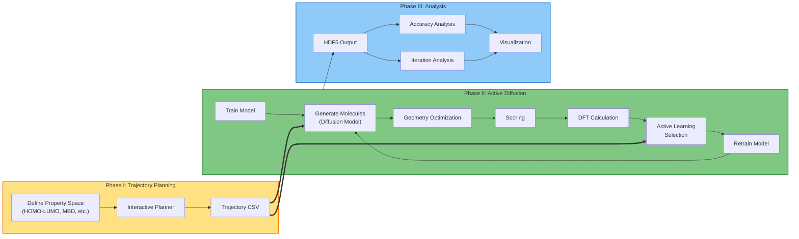
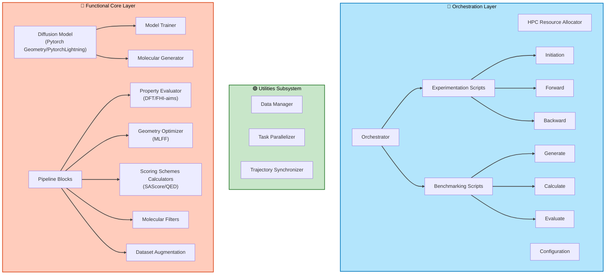

# EQMgen: Efficient Quantum-Mechanical AI model GENerator

[](LICENSE)
[](https://www.python.org/downloads/)

This model uses the Diffusion model and Density Functional Theory (DFT) through active learning to navigate chemical space and improve our generative model for molecular design.


## Overview

The EQMgen framework combines diffusion models with quantum mechanical calculations to generate novel molecules with desired properties. The system leverages active learning to iteratively improve molecular generation by incorporating DFT feedback, enabling efficient exploration of chemical space.

**Key Features:**
- Molecular trajectory planning in property space
- Iterative active learning with DFT feedback
- HPC-optimized workflow orchestration
- Comprehensive analysis and visualization tools
- Property-guided molecular generation

## WorkFlow

The software system is organized into a modular architecture that follows a three-phase workflow, guiding the process from molecular trajectory design to data analysis. 



### Phase I – Trajectory Planning

This phase provides an interactive environment for defining molecular trajectories within a property space (e.g., HOMO-LUMO gap, many-body dispersion energy, atomic number). The resulting trajectory files (`trajectory_*.csv`) serve as input for the active learning process. 


**Tools:** Interactive trajectory planner in `Navigator/design_trajectory.ipynb`

### Phase II – Active Diffusion Execution

This represents the core operational layer of the system, responsible for orchestrating the iterative molecular generation, evaluation, and feedback process. 


### Phase III – Output Analysis

The final phase focuses on analyzing and visualizing the output. Jupyter notebooks in the `Navigator/` directory allow users to inspect the active diffusion results, model performance, and generated molecular properties (HDF5 outputs).


## Active Diffusion Architecture

The architectural elements are organized as follows:

### Surface Layer – Experiment Orchestration Layer
Responsible for workflow coordination, configuration management, and resource allocation across HPC environments. It defines the experiment lifecycle.

### Deep Layer – Functional Core Layer 
Contains the domain-specific components that implement the scientific and computational functionality of the diffusion process, including molecular generation and property evaluation.

### Utilities Subsystem 
Provides cross-cutting services that support both layers by handling data management, task parallelization, and trajectory synchronization.




## Installation

### Prerequisites

- Python 3.10 or higher
- Mamba or Conda package manager
- Access to HPC cluster with SLURM
- CUDA-capable GPU (for forward pipeline)
- Multi-core CPU system (for backward pipeline)

### Installation Steps

1. **Clone the repository:**

```bash
git clone <repository-url>
cd EQMgen
```

2. **Create the conda environment:**

```bash
mamba env create -f environment-al.yml -p conda_envs/env-activeloop/
```

Alternatively, if you prefer to manage the environment separately:

```bash
mamba env create -f environment-al.yml -n env-activeloop
```

3. **Activate the environment:**

```bash
conda activate ./conda_envs/env-activeloop/
# or if using named environment:
# conda activate env-activeloop
```

4. **Replace the installed ASE DFTB calculator file with the repository patch:**

```bash
python - <<'PY'
from pathlib import Path
import shutil
import ase.calculators.dftb as ase_dftb

repo_root = Path.cwd()
src = repo_root / "dftb.py"
dst = Path(ase_dftb.__file__)

if not src.exists():
    raise FileNotFoundError(f"Missing source patch file: {src}")

backup = dst.with_suffix(dst.suffix + ".bak")
if not backup.exists():
    shutil.copy2(dst, backup)

shutil.copy2(src, dst)
print(f"Patched ASE DFTB calculator: {dst}")
print(f"Backup created at: {backup}")
PY
```

5. **Configure the code config path and SKfiles location:**

```bash
export CONFIG="$PWD/EQMgen/configs"
export DFTB_PREFIX="$CONFIG/SKfiles/3ob-3-1/"
```

6. **Ensure SKfiles are available under the code config directory:**

```bash
test -d "$CONFIG/SKfiles/3ob-3-1" && echo "SKfiles found under $CONFIG"
```

If SKfiles are stored elsewhere, copy them into `$CONFIG/SKfiles/` before running forward/backward jobs.

> **Note:** `environment-al.yml` produces a single combined environment (`env-activeloop`) that contains both the GPU/diffusion stack (PyTorch, PyTorch Geometric, MACE) and the chemistry/DFT stack (ASE, RDKit, xTB, DFTB+). Both the forward and backward job scripts activate this same environment.

## HPC Cluster Configuration (SLURM)

The EQMgen workflow is designed to run on HPC clusters using SLURM. The workflow is split into two complementary job types:

### Forward Pipeline (GPU Cluster)

**Script:** `Experiments/templates/jobs/eqmgen_forward.sh`

The forward pipeline runs **on GPU clusters** and handles:
- Diffusion model training
- Molecular generation
- Model inference

**Default SLURM Configuration:**
- **Partition:** `capella` (GPU partition)
- **GPU:** 1 GPU per job
- **CPU:** 6 cores per task
- **Memory:** 8000 MB per CPU
- **Nodes:** 1
- **Time:** 20 hours

**Update cluster parameters before running:**

Edit `Experiments/templates/jobs/eqmgen_forward.sh` to match your GPU cluster specifications:

```bash
#SBATCH --partition=your_gpu_partition    # Change to your GPU partition name
#SBATCH --gres=gpu:X                       # Adjust number of GPUs (1, 2, 4, etc.)
#SBATCH --cpus-per-task=6                  # Adjust CPU cores
#SBATCH --mem-per-cpu=8000                 # Adjust memory per CPU
#SBATCH --time=HH:MM:SS                    # Adjust time limit
```

### Backward Pipeline (Heavy CPU Cluster)

**Script:** `Experiments/templates/jobs/eqmgen_backward.sh`

The backward pipeline runs **on heavy CPU clusters** and handles:
- DFT calculations (FHI-aims)
- Geometry optimization
- Property evaluation
- DFTB+ calculations

**Default SLURM Configuration:**
- **Partition:** `barnard` (CPU partition)
- **CPU:** 32 tasks per node
- **Nodes:** 10 (distributed computing)
- **Memory:** 12000 MB per CPU
- **Account:** `p_nanoparticle`
- **Time:** 5 hours
- **Module dependencies:** FHI-aims, Intel compiler, MPI

**Update cluster parameters before running:**

Edit `Experiments/templates/jobs/eqmgen_backward.sh` to match your CPU cluster specifications:

```bash
#SBATCH -A your_account              # Change to your SLURM account
#SBATCH --partition=your_cpu_partition
#SBATCH --cpus-per-task=X            # Adjust CPUs per task
#SBATCH --mem-per-cpu=XXXX           # Adjust memory per CPU
#SBATCH --nodes=X                    # Adjust number of nodes
#SBATCH --ntasks-per-node=X          # Adjust tasks per node
#SBATCH --time=HH:MM:SS              # Adjust time limit
```

Additionally, update the module load commands if your cluster has different module names:

```bash
# Original (example):
module load release/24.04 intel-compilers/2023.2.1 impi/2021.10.0
module load FHI-aims/240507

# Update to your cluster's available modules:
module load <release> <compiler> <mpi>
module load <fhi-aims-module>
```

### Setting Up Experiments with Cluster Information

When initializing a new experiment, the job scripts are copied from `Experiments/templates/jobs/` to your experiment directory. **You must customize these scripts for your specific cluster before running experiments.**

**Workflow:**

1. **Initialize experiment:**

```bash
python EQMgen/scripts/init_experiment.py --name my_exp --dataset-path /path/to/dataset.hdf5
```

This creates:
```
Experiments/my_exp_0/
├── configs/
│   └── experiment_config.yaml
├── jobs/
│   ├── eqmgen_forward.sh      # ← CUSTOMIZE FOR YOUR GPU CLUSTER
│   └── eqmgen_backward.sh     # ← CUSTOMIZE FOR YOUR CPU CLUSTER
├── logs/
└── results/
```

2. **Customize SLURM parameters in the generated job scripts** for your cluster:

```bash
cd Experiments/my_exp_0/jobs

# Edit forward script:
nano eqmgen_forward.sh
# Update: partition, GPU count, CPU cores, memory, time, conda environment path

# Edit backward script:
nano eqmgen_backward.sh
# Update: account, partition, node count, tasks per node, memory, time, module loads, conda environment path
```

3. **Verify the conda environment path:**

Both scripts activate the same combined environment. Ensure the path matches your setup:

```bash
# In both eqmgen_forward.sh and eqmgen_backward.sh:
conda activate $REPO_ROOT/conda_envs/env-activeloop
```

If you installed the environment under a different name or location, update these lines accordingly.

4. **Test a job submission:**

```bash
cd Experiments/my_exp_0/jobs
sbatch eqmgen_forward.sh    # Test forward job
# or
sbatch eqmgen_backward.sh   # Test backward job
```

5. **Monitor job status:**

```bash
squeue -u $USER
squeue -j <job_id>          # Check specific job
```

## Quick Start

1. **Initialize an experiment**

```bash
python EQMgen/scripts/init_experiment.py --name my_exp --dataset-path /path/to/base_dataset.hdf5
```

2. **Edit experiment config**

Update the generated file:

`Experiments/my_exp_0/configs/experiment_config.yaml`

3. **Customize SLURM job scripts** (see "HPC Cluster Configuration" section above)

4. **Copy Navigator trajectory CSV files**

Copy Navigator trajectory CSV files into `Experiments/my_exp_0/configs/`

5. **Submit forward/backward jobs**

```bash
cd Experiments/my_exp_0/jobs
sbatch eqmgen_forward.sh
sbatch eqmgen_backward.sh
```

6. **Analyze results**

Generated iteration data and HDF5 outputs are written under:

`Data/my_exp_0/`


## Project Structure

```
EQMgen/
├── Data/                            # Experiment data root (created/updated at runtime)
├── EQMgen/
│   ├── configs/                     # Framework configs (eqdiff_model.yaml, eqmgen_paths.yaml, SKfiles)
│   ├── eqdiff/                      # Diffusion model code
│   ├── pipeline_blocks/             # Geometry/props/filter/hdf5 blocks
│   ├── scripts/                     # init_experiment.py, forward.py, backward.py
│   └── utils/                       # Data manager, trajectory, parallelization helpers
├── Experiments/
│   └── templates/                   # Template config and job scripts for initialization
├── Navigator/                       # Interactive trajectory planner (design_trajectory.ipynb)
├── environment-al.yml               # Combined conda environment specification
├── global_config.yaml               # Root/shared config imported by experiments
└── README.md
```

## Requirements

Core dependencies include:
- PyTorch
- NumPy
- Pandas
- RDKit
- ASE (Atomic Simulation Environment)
- Matplotlib/Seaborn (visualization)
- Jupyter (analysis notebooks)

See `environment-al.yml` for a complete list.

