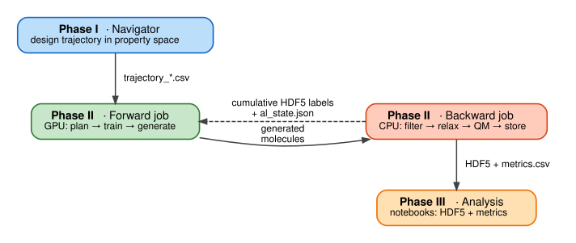
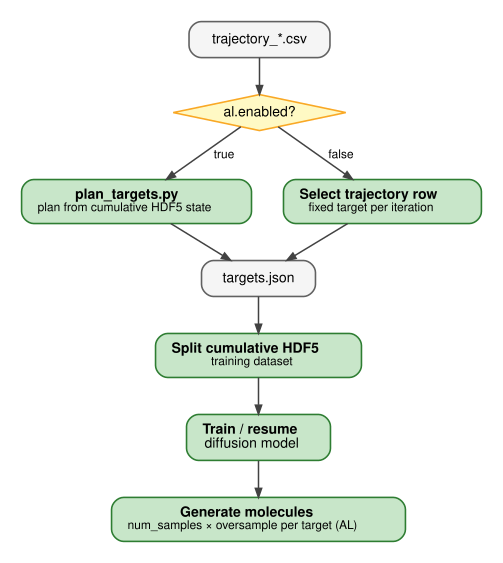
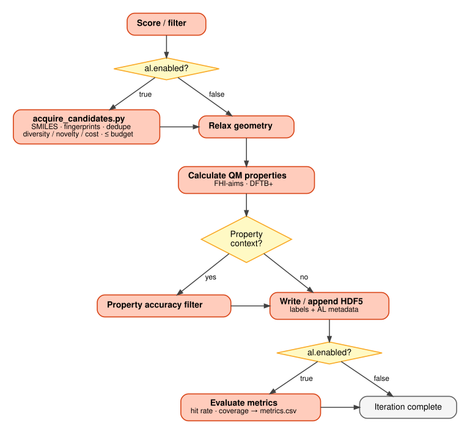
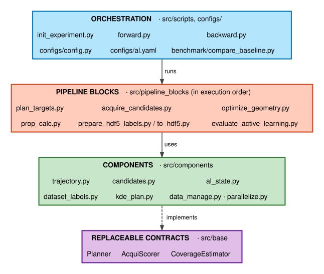

# QALPA – Quantum-Aware Learning for Property-Space Augmentation

[](LICENSE)
[](https://www.python.org/downloads/)

QALPA combines diffusion-based molecular generation with quantum-mechanical (QM) feedback through active learning (AL). It explores property space and iteratively improves generative models for molecular design.

<p align="center">

</p>

<details>
<summary><b>Reading the figure</b></summary>

| # | Step | Job | Active learning |
|:-:|------|-----|:---:|
| 1 | **EQDIFF** – train / resume the diffusion model on the weighted concatenated dataset | Forward (GPU) | |
| 2 | **Target planning** – KDE-map corridor over sparse, under-explored and hard regions | Forward (GPU) | AL |
| 3 | **Acquisition** – dedupe, fingerprints, diversity/novelty and cost, at most `budget` candidates | Backward (CPU) | AL |
| 4 | **EquiDTB** – geometry optimization | Backward (CPU) | |
| 5 | **Property calculation** – FHI-aims (DFT) or DFTB+ | Backward (CPU) | |
| 6 | **Data screening** – property accuracy, synthetic accessibility (SA) score | Backward (CPU) | |
| 7 | **Evaluation** – hit rate, coverage, `metrics.csv`, optional early stop | Backward (CPU) | AL |
| 8 | **Weighted concatenation** – initial and per-iteration labelled data, each with a weight, form the training set of the next round | Dataset | |

The loop ends when `q > N_iter` or early stopping triggers; the final dataset is then written.

</details>

**Contents:** [Overview](#overview) · [Workflow](#workflow) · [Architecture](#architecture) · [Installation](#installation) · [Quick Start](#quick-start) · [HPC (SLURM)](#hpc-configuration-slurm) · [Requirements](#requirements) · [Troubleshooting](#troubleshooting) · [Citation](#citation)

---

## Overview

QALPA generates novel molecules with desired properties by coupling a diffusion model with QM calculations. After every iteration, active learning feeds the new quantum property data back into the model, so chemical space is explored efficiently.

| Feature | Details |
|---------|---------|
| Trajectory planning | Molecular trajectories in property space (HOMO-LUMO gap, many-body dispersion energy, atomic number, …) |
| Active learning | Iterative loop: EquiDTB geometry optimization, DFT / DFTB+ property feedback |
| Orchestration | HPC-optimized, SLURM-based forward/backward jobs |
| Generation | Property-guided diffusion model |
| Analysis | Notebooks for HDF5 outputs, metrics and visualization |
| QM packages | **FHI-aims** and **DFTB+** |

---

## Workflow

QALPA runs in three phases: trajectory design, active diffusion execution, and output analysis.

<p align="center">

</p>

| Phase | What happens | Tool / script |
|-------|--------------|---------------|
| **I – Trajectory planning** | Define a trajectory in property space and export `trajectory_*.csv` | `Navigator/design_trajectory.ipynb` |
| **II – Active diffusion** | Iterate forward (GPU) and backward (CPU) jobs | `src/scripts/forward.py`, `src/scripts/backward.py` |
| **III – Output analysis** | Inspect results, model performance and generated molecular properties | Notebooks in `Navigator/` |

### Phase I – Trajectory planning

The resulting `trajectory_*.csv` files are consumed by `forward.py`. With active learning enabled, they define the corridor from which targets are planned.

<p align="center">

</p>

### Phase II – Active diffusion execution

Each iteration is executed by two jobs. Submit them **alternately**, so generated molecules are available to the backward job and updated HDF5 labels are available to the next forward job.

| Job | Hardware | Responsibility |
|-----|----------|----------------|
| **Forward** | GPU | Prepare data, train or resume the diffusion model, generate molecules |
| **Backward** | CPU | Filter and evaluate molecules, run QM, persist labels for the next iteration |

#### Forward job

<p align="center">

</p>

#### Backward job

<p align="center">

</p>

#### Active learning (`al:` block in `experiment_config.yaml`)

With `al.enabled: true`, one iteration proceeds as follows:

| # | Job | Step | What it does |
|:-:|-----|------|--------------|
| 1 | Forward | **Plan** | `plan_targets.py` loads the cumulative HDF5 state and writes `targets.json`. `kde_map` samples a padded trajectory corridor and scores sparse, under-explored and historically difficult regions. `trajectory` and `frontier` are simpler alternatives. |
| 2 | Forward | **Split / train / generate** | The labelled HDF5 is split into a training set, the diffusion model is trained or resumed on the weighted concatenation of the labelled data, and molecules are generated per planned target. Candidate pool size is `num_samples * oversample`. |
| 3 | Backward | **Score and acquire** | Score filters run first. `acquire_candidates.py` converts structures to canonical SMILES and Morgan fingerprints, removes invalid and duplicate candidates, and selects at most `budget` candidates by fingerprint diversity/novelty and heavy-atom cost. `random` mode is a baseline. No predictive surrogate is used. |
| 4 | Backward | **Relax and calculate** | Selected candidates undergo geometry optimization and QM property calculation. Optional property-accuracy filtering removes candidates outside the configured tolerance. |
| 5 | Backward | **Persist and evaluate** | Valid results are written to the cumulative HDF5 together with AL metadata (requested and achieved properties, target IDs, iteration, hit flags). Evaluation appends hit rate, coverage, selected count and acquisition-score metrics to `<experiment>/metrics.csv`. Optional early stopping sets `loop.stop`. |

**Running without active learning:** set `al.enabled: false` to use the fixed trajectory row for each iteration. Target planning, candidate acquisition and AL evaluation are skipped. The forward job generates the configured number of molecules, and the backward job runs the regular score/filter, relaxation, property and HDF5 stages.

**Constraints and sidecar files**

| Item | Note |
|------|------|
| `kde_map` planner | Needs at least two trajectory rows and `hdf5.appending_flag: true` |
| AL sidecar files | `al_state.json`, `validation_ids.json`, `metrics.csv`, `al_cache/` (fingerprint cache) |

### Phase III – Output analysis

Jupyter notebooks in `Navigator/` let you inspect the active diffusion results, model performance and generated molecular properties (HDF5 outputs).

---

## Architecture

The code is organized in four layers, each depending only on the layers below it.

<p align="center">

</p>

| Layer | Location | Responsibility |
|-------|----------|----------------|
| **Orchestration** | `src/scripts`, `src/configs/config.py` | Experiment initialization, forward/backward loop, configuration loading and validation |
| **Pipeline blocks** | `src/pipeline_blocks` | Planning, candidate acquisition, filtering, geometry optimization, property calculation, HDF5 preparation, evaluation |
| **Components** | `src/components` | Trajectory and candidate persistence, dataset-label contracts, AL state, KDE planning/scoring/coverage, data management, parallelization |
| **Contracts** | `src/base` | Interfaces that keep planning, acquisition scoring and coverage estimation replaceable |

**Pipeline execution order**

| Step | Job | Block | Purpose |
|:----:|-----|-------|---------|
| 1 | Forward | `plan_targets.py` | Plan targets |
| 2 | Forward | dataset split | Build training data |
| 3 | Forward | diffusion train / generate | Generate candidates |
| 4 | Backward | `acquire_candidates.py` | Select candidates (AL only) |
| 5 | Backward | `optimize_geometry.py` | Relax geometries |
| 6 | Backward | `prop_calc.py` | QM properties |
| 7 | Backward | `prepare_hdf5_labels.py`, `to_hdf5.py` | Persist labels |
| 8 | Backward | `evaluate_active_learning.py` | Metrics (AL only) |

**Contracts and their implementations**

| Contract (`src/base`) | Implemented by | Used by |
|-----------------------|----------------|---------|
| `planner.py` – `Planner`, `PlanningRequest` | `components/kde_plan.py` | `plan_targets.py` |
| `acquisition.py` – `AcquiScorer` | `components/kde_plan.py` | `acquire_candidates.py` |
| `coverage.py` – `CoverageEstimator` | `components/kde_plan.py` | `evaluate_active_learning.py` |

Import workflow steps from `src.pipeline_blocks` and reusable logic from `src.components`. Evaluation metrics live with the evaluation block.

<details>
<summary><b>Source tree (active-learning related)</b></summary>

```text
src/
├── pipeline_blocks/            # Workflow steps called by forward/backward
│   ├── acquire_candidates.py
│   ├── prepare_hdf5_labels.py
│   ├── plan_targets.py
│   └── evaluate_active_learning.py
├── components/
│   ├── al_state.py             # AL state persistence and records
│   ├── surrogate.py            # Optional surrogate-model components
│   ├── candidates.py           # Candidate IDs and metadata
│   ├── dataset_labels.py       # Dataset label extraction and QM result validation
│   ├── trajectory.py           # Trajectory CSV handling, Target model, targets.json
│   └── data_manage.py, parallelize.py, mol_calculate.py
├── base/
│   ├── planner.py              # Planner and PlanningRequest contracts
│   ├── acquisition.py          # Acquisition scorer contract
│   └── coverage.py             # Coverage estimator contract
├── configs/
│   ├── al.yaml                 # Declarative AL defaults
│   ├── datasets/
│   │   └── qm7.yaml            # Default dataset schema and atomic references
│   └── config.py               # AL loading, validation, paths, workflow helpers
└── benchmark/                  # Synthetic planner/acquisition comparisons
    └── compare_baseline.py
```

</details>

<details>
<summary><b>Dataset configuration and label contract</b></summary>

Dataset-specific QM JSON mappings, required fields, supported elements and atomic reference energies are defined in `src/configs/datasets/qm7.yaml`. Experiments use QM7 by default. To use another dataset, copy that file, customize it, and set `al.dataset_config` in the experiment configuration to the new YAML path.

| Key | Purpose |
|-----|---------|
| `hdf5_labels` | Labels written by the HDF5 conversion block |
| `extra_hdf5_labels` | Optional force / charge / volume labels |
| `training_labels` | Label order consumed by data splitting and augmentation |

The shared provider in `src/components/dataset_labels.py` reads, derives and validates these labels, so AL validation, HDF5 conversion and AQM data preparation use one dataset-specific source. AL hit and target metadata assembly stays with the HDF5 preparation block because it is workflow-specific.

Trajectory planning lives in [`trajectory.py`](src/components/trajectory.py) (trajectory CSV access, the `Target` model, `targets.json` persistence). `components/candidates.py` owns candidate IDs, names and metadata persistence.

</details>


---

## Installation

### Prerequisites

- Python 3.10+
- Mamba or Conda
- HPC cluster with SLURM
- CUDA-capable GPU (forward pipeline) and a multi-core CPU system (backward pipeline)

### Choose an environment strategy

| | **Split** (recommended) | **Combined** |
|---|---|---|
| Environments | `env-qalpa-forward` + `env-qalpa-backward` | `env-activeloop` |
| Spec files | `environment_f.yml`, `environment_b.yml` | `environment-al.yml` |
| Best for | HPC clusters, production | Development, single-machine tests |
| Pros | Smaller per-node installs, hardware-specific, scalable | One environment, simple |
| Cons | Two environments to manage | Larger download, slower install |

### Split environments (recommended)

1. **Clone the repository**

   ```bash
   git clone <repository-url>
   cd <repository-folder>
   ```

2. **Create the forward (GPU) and backward (CPU) environments**

   ```bash
   mamba env create -f environment_f.yml -p conda_envs/env-qalpa-forward/
   mamba env create -f environment_b.yml -p conda_envs/env-qalpa-backward/
   ```

3. **Patch the backward environment's ASE DFTB calculator**

   ```bash
   ASE_DFTB="./conda_envs/env-qalpa-backward/lib/python3.10/site-packages/ase/calculators/dftb.py"
   cp "$ASE_DFTB" "${ASE_DFTB}.bak"
   cp src/dftb.py "$ASE_DFTB"
   ```

4. **Export the SKfiles path** (both environments)

   ```bash
   export DFTB_PREFIX="$PWD/src/configs/SKfiles/3ob-3-1/"
   ```

5. **Point the job scripts at the split environments**

   | Script | Line |
   |--------|------|
   | `Experiments/templates/jobs/eqmgen_forward.sh` | `conda activate $REPO_ROOT/conda_envs/env-qalpa-forward/` |
   | `Experiments/templates/jobs/eqmgen_backward.sh` | `conda activate $REPO_ROOT/conda_envs/env-qalpa-backward/` |

<details>
<summary><b>Combined environment (development / single machine)</b></summary>

```bash
mamba env create -f environment-al.yml -p conda_envs/env-activeloop/
```

Apply the same ASE DFTB patch and `DFTB_PREFIX` export as above, then activate `env-activeloop` in both job scripts:

```bash
conda activate $REPO_ROOT/conda_envs/env-activeloop/
```

</details>

---

## Quick Start

1. **Initialize an experiment**

   ```bash
   python src/scripts/init_experiment.py --name my_exp --dataset-path /path/to/base_dataset.hdf5
   ```

   ```text
   Experiments/my_exp_0/
   ├── configs/
   │   └── experiment_config.yaml
   ├── jobs/
   │   ├── eqmgen_forward.sh      # runs on the GPU cluster
   │   └── eqmgen_backward.sh     # runs on the heavy CPU cluster
   ├── logs/
   └── results/
   ```

2. **Edit the config:** `Experiments/my_exp_0/configs/experiment_config.yaml`
3. **Adapt the SLURM job scripts** to your cluster (see [HPC Configuration](#hpc-configuration-slurm))
4. **Copy the Navigator trajectory CSV files** into `Experiments/my_exp_0/configs/`
5. **Submit the jobs**

   ```bash
   cd Experiments/my_exp_0/jobs
   sbatch eqmgen_forward.sh
   sbatch eqmgen_backward.sh
   ```

6. **Monitor**

   ```bash
   squeue -u $USER
   squeue -j <job_id>
   ```

7. **Analyze results:** iteration data and HDF5 outputs are written to `Data/my_exp_0/`

---

## HPC Configuration (SLURM)

Job scripts are copied from `Experiments/templates/jobs/` into your experiment directory on initialization. **Adapt them to your cluster before submitting.**

| Setting | Forward (GPU) | Backward (CPU) |
|---------|---------------|----------------|
| Script | `eqmgen_forward.sh` | `eqmgen_backward.sh` |
| Partition | `capella` | `barnard` |
| Nodes | 1 | 10 |
| Tasks / CPUs | 6 CPUs per task | 32 tasks per node |
| GPUs | 1 | – |
| Memory | 8000 MB per CPU | 12000 MB per CPU |
| Time limit | 20 h | 5 h |
| Account | – | your SLURM project account |
| Handles | Diffusion training, generation, inference | EquiDTB geometry optimization, FHI-aims DFT, DFTB+, property evaluation |
| Modules | – | FHI-aims, Intel compiler, MPI |

<details>
<summary><b>Forward job – directives to edit</b></summary>

```bash
#SBATCH --partition=your_gpu_partition    # your GPU partition name
#SBATCH --gres=gpu:X                      # number of GPUs (1, 2, 4, ...)
#SBATCH --cpus-per-task=6                 # CPU cores
#SBATCH --mem-per-cpu=8000                # memory per CPU (MB)
#SBATCH --time=HH:MM:SS                   # time limit
```

</details>

<details>
<summary><b>Backward job – directives and modules to edit</b></summary>

```bash
#SBATCH -A your_account                   # your SLURM account
#SBATCH --partition=your_cpu_partition
#SBATCH --cpus-per-task=X
#SBATCH --mem-per-cpu=XXXX
#SBATCH --nodes=X
#SBATCH --ntasks-per-node=X
#SBATCH --time=HH:MM:SS
```

```bash
# Original (example):
module load release/24.04 intel-compilers/2023.2.1 impi/2021.10.0
module load FHI-aims/240507

# Replace with your cluster's modules:
module load <release> <compiler> <mpi>
module load <fhi-aims-module>
```

</details>

<details>
<summary><b>Switching between split and combined environments</b></summary>

The templates use split environments by default. To use the combined environment, replace the two `conda activate` lines in both job scripts with:

```bash
conda activate $REPO_ROOT/conda_envs/env-activeloop/
```

</details>

---

## Project Structure

```text
<repo>/
├── Data/                     # Experiment data root (created/updated at runtime)
├── docs/diagrams/            # Graphviz sources (.dot) and rendered SVGs
├── src/
│   ├── configs/              # Framework configs (eqdiff_model.yaml, eqmgen_paths.yaml, SKfiles)
│   ├── eqdiff/               # Diffusion model code
│   ├── pipeline_blocks/      # Geometry / props / filter / HDF5 blocks
│   ├── scripts/              # init_experiment.py, forward.py, backward.py
│   └── components/           # Data manager, trajectory, parallelization helpers
├── Experiments/
│   └── templates/            # Template config and job scripts
├── Navigator/                # Interactive trajectory planner (design_trajectory.ipynb)
├── environment-al.yml        # Combined conda environment
├── environment_f.yml         # Forward (GPU) environment
├── environment_b.yml         # Backward (CPU) environment
├── global_config.yaml        # Root/shared config imported by experiments
└── README.md
```

---

## Requirements

| File | Contents | Use |
|------|----------|-----|
| `environment-al.yml` | GPU/diffusion + chemistry/DFT stacks | Single-machine setup |
| `environment_f.yml` | PyTorch, PyTorch Geometric, MACE | Forward pipeline (GPU) |
| `environment_b.yml` | ASE, RDKit, xTB, DFTB+ | Backward pipeline (CPU) |

| Area | Packages | Found in |
|------|----------|----------|
| Deep learning / diffusion | Python 3.10, PyTorch 2.0.1, PyTorch Geometric 2.3.0 (`pytorch-scatter`, `-sparse`, `-cluster`), PyTorch Lightning 2.0.6, `torch_ema`, TensorBoard, MACE (from source), JAX (CUDA 12) | `environment-al.yml`, `environment_f.yml` |
| Quantum chemistry / structure | ASE, DFTB+ 24.1 (`dftbplus`, `dftbplus-tools`, `dftbplus-python`), xTB (`xtb`, `xtb-python`), RDKit 2023.03.2, Open Babel | `environment-al.yml`, `environment_b.yml` |
| Configuration / data | Hydra / OmegaConf, NumPy (<2), Pandas, h5py, LMDB | all |
| Visualization / analysis | Matplotlib, Seaborn, Jupyter, py3Dmol, nglview, RMSD, Biopython | all |

> FHI-aims is **not** installed via conda. It is loaded as an HPC module.
> See the environment YAML files for complete, version-pinned lists.

---

## Troubleshooting

<details>
<summary><code>ModuleNotFoundError: Neither tensorboard nor tensorboardX is available</code></summary>

`tensorboard` is declared in the environment files but may be missing if the environment was created from an older version.

```bash
# Combined environment
conda_envs/env-activeloop/bin/pip3 install tensorboard

# Split environments
conda_envs/env-qalpa-forward/bin/pip3 install tensorboard
conda_envs/env-qalpa-backward/bin/pip3 install tensorboard
```

Then re-submit the job.

</details>

<details>
<summary><code>ModuleNotFoundError: No module named 'pkg_resources'</code></summary>

`setuptools>=70` removed `pkg_resources` as a top-level module, which breaks `pytorch-lightning` and other packages. The environment files pin `setuptools<70`. If your environment was created without this pin:

```bash
# Combined environment
conda_envs/env-activeloop/bin/python -m pip install "setuptools<70" --force-reinstall

# Split environments
conda_envs/env-qalpa-forward/bin/python -m pip install "setuptools<70" --force-reinstall
conda_envs/env-qalpa-backward/bin/python -m pip install "setuptools<70" --force-reinstall
```

</details>

---

## Citation

If you use parts of the code, please cite:

```bibtex
@article{qalpa,
  title   = {QALPA: Property-guided diffusion modeling for efficient exploration of chemical spaces of flexible molecules},
  author  = {Michael Hanna and Julian Cremer and Zekiye Erarslan and Leonardo Medrano Sandonas},
  year    = {2026},
  journal = {arXiv preprint arXiv:2609.16527},
  url     = {https://arxiv.org/abs/2609.16527}
}
```
