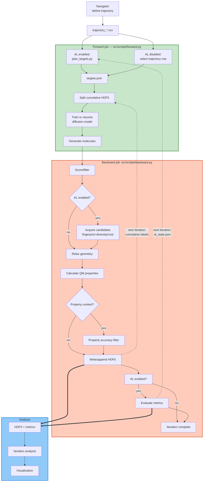
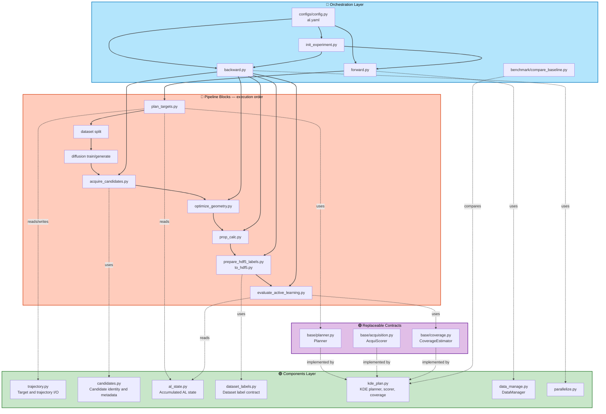

# QALPA - Quantum-Aware Learning for Property-Space Augmentation

[](LICENSE)
[](https://www.python.org/downloads/)

QALPA combines diffusion-based molecular generation with quantum-mechanical feedback through active learning to explore property space and improve generative models for molecular design. 

<p align="center">

</p>

## Overview

The QALPA framework combines diffusion models with quantum-mechanical (QM) calculations to generate novel molecules with desired properties. The system leverages active learning (AL) to iteratively improve molecular generation by incorporating quantum property data feedback, enabling efficient exploration of chemical space.

**Key Features:**
- Molecular trajectory planning in property space
- Iterative active learning with DFT and EquiDTB feedback
- HPC-optimized workflow orchestration
- Comprehensive analysis and visualization tools
- Property-guided molecular generation
- The QM packages currently implemented are FHI-aims and DFTB+.

## WorkFlow

The software system is organized into a modular architecture that follows a three-phase workflow, guiding the process from molecular trajectory design to data analysis. 



### Phase I – Trajectory Planning

This phase provides an interactive environment for defining molecular trajectories within a property space (e.g., HOMO-LUMO gap, many-body dispersion energy, atomic number). The resulting trajectory files (`trajectory_*.csv`) are consumed by `forward.py`; with active learning enabled, they define the corridor from which targets are planned.


**Tools:** Interactive trajectory planner in `Navigator/design_trajectory.ipynb`

### Phase II – Active Diffusion Execution

This represents the core operational layer of the system. Each iteration is executed by two jobs: the forward job prepares data and generates molecules, and the backward job evaluates those molecules and persists the resulting labels for the next iteration.

#### Active learning (`al:` block in `experiment_config.yaml`)

With `al.enabled: true`, one iteration proceeds as follows:

1. **Forward: plan** – `plan_targets.py` loads the cumulative HDF5 state and writes `targets.json`. `kde_map` samples a padded trajectory corridor and scores sparse, under-explored, and historically difficult regions; `trajectory` and `frontier` are simpler alternatives.
2. **Forward: split/train/generate** – the labelled HDF5 is split into a training dataset, the diffusion model is trained or resumed, and molecules are generated for each planned target. The total candidate pool is `num_samples * oversample`.
3. **Backward: score and acquire** – score filters run first. `acquire_candidates.py` converts structures to canonical SMILES and Morgan fingerprints, removes invalid/duplicate candidates, and selects at most `budget` candidates using fingerprint diversity/novelty and heavy-atom cost. `random` mode provides a baseline; no predictive surrogate is used.
4. **Backward: relax and calculate** – selected candidates undergo geometry optimization and QM property calculation. Optional property-accuracy filtering can remove candidates outside the configured tolerance.
5. **Backward: persist and evaluate** – valid results are written to the cumulative HDF5. Active-learning metadata records requested properties, achieved properties, target IDs, iteration, and hit flags. Evaluation appends hit rate, coverage, selected-count, and acquisition-score metrics to `<experiment>/metrics.csv`; optional early stopping sets `loop.stop`.

Run with `al.enabled: false` to use the fixed trajectory row for each iteration. In that mode, target planning, candidate acquisition, and active-learning evaluation are skipped; the forward job generates the configured number of molecules and the backward job runs the regular score/filter, relaxation, property, and HDF5 stages. `kde_map` needs at least two trajectory rows and `hdf5.appending_flag: true`. Submit forward and backward alternately so generated molecules are available to the backward job and updated HDF5 labels are available to the next forward job. Active-learning sidecar files are `al_state.json`, `validation_ids.json`, `metrics.csv`, and the `al_cache/` fingerprint cache.


### Phase III – Output Analysis

The final phase focuses on analyzing and visualizing the output. Jupyter notebooks in the `Navigator/` directory allow users to inspect the active diffusion results, model performance, and generated molecular properties (HDF5 outputs).


## Active Diffusion Architecture

The architectural elements are organized as follows:

The active-learning implementation follows the same block/component separation as
the rest of `src`:

```text
src/
├── pipeline_blocks/        # Workflow steps called by forward/backward
│   ├── acquire_candidates.py
│   ├── prepare_hdf5_labels.py
│   ├── plan_targets.py
│   └── evaluate_active_learning.py
├── components/
│   ├── al_state.py           # Active-learning state persistence and records
│   ├── surrogate.py          # Optional surrogate-model components
│   ├── candidates.py         # Candidate IDs and candidate metadata
│   ├── dataset_labels.py     # Dataset label extraction and QM result validation
│   ├── trajectory.py         # Generic trajectory CSV handling
│   └── data_manage.py, parallelize.py, mol_calculate.py
├── base/
│   ├── planner.py       # Planner and PlanningRequest contracts
│   ├── acquisition.py   # Acquisition scorer contract
│   └── coverage.py      # Coverage estimator contract
├── configs/
│   ├── al.yaml  # Declarative AL defaults
│   ├── datasets/
│   │   └── qm7.yaml  # Default dataset schema and atomic references
│   └── config.py  # AL loading, validation, paths, and workflow helpers
└── benchmark/              # Synthetic planner/acquisition comparisons
    └── compare_baseline.py
```

The benchmark package contains the synthetic comparison executable. Workflow
steps should be imported from `src.pipeline_blocks`, and reusable logic from
`src.components`; evaluation metrics are kept with the evaluation block.

Trajectory planning is kept together in [trajectory.py](src/components/trajectory.py):
it contains trajectory CSV access plus the `Target` model and persistence for
planned `targets.json` files. `components/candidates.py` owns candidate IDs, names,
and candidate metadata persistence.

Dataset-specific QM JSON mappings, required fields, supported elements, and
atomic reference energies are defined in `src/configs/datasets/qm7.yaml`.
Experiments use QM7 by default. To use another dataset, copy that file,
customize it, and set `al.dataset_config` in the experiment configuration to
the new YAML path.

The same dataset file also owns the label contract:

- `hdf5_labels` defines labels written by the HDF5 conversion block.
- `extra_hdf5_labels` defines optional force/charge/volume labels.
- `training_labels` defines the label order consumed by data splitting and
  augmentation.

The shared provider in `src/components/dataset_labels.py` reads, derives, and
validates these labels. Active-learning validation, HDF5 conversion, and AQM
data preparation therefore use one dataset-specific source instead of
duplicating QM7 label logic. Active-learning hit and target metadata assembly
remains with the HDF5 preparation block because it is workflow-specific.

### Orchestration Layer
The scripts in `src/scripts` coordinate experiment initialization and the forward/backward iteration loop. Configuration loading and validation are centralized in `src/configs/config.py`.

### Pipeline Layer
The blocks in `src/pipeline_blocks` implement planning, candidate acquisition, filtering, geometry optimization, property calculation, HDF5 preparation, and evaluation.

### Components Layer
The reusable components in `src/components` provide trajectory and candidate persistence, dataset-label contracts, active-learning state handling, KDE planning/scoring/coverage, data management, and parallelization. The base interfaces in `src/base` keep planning, acquisition scoring, and coverage estimation replaceable.




`surrogate.py` contains an optional fingerprint random-forest implementation for
standalone experiments and benchmark comparisons. It is not part of the current
candidate-acquisition path: acquisition runs before trusted QM properties exist
and therefore uses only observable molecular structure features.

## Installation

### Prerequisites

- Python 3.10 or higher
- Mamba or Conda package manager
- Access to HPC cluster with SLURM
- CUDA-capable GPU (for forward pipeline)
- Multi-core CPU system (for backward pipeline)

### Installation Options

The project supports two environment configuration strategies:

| Approach | Environments | Use Case | Pros | Cons |
|----------|---|----------|------|------|
| **Split** | `env-qalpa-forward` + `env-qalpa-backward` | HPC clusters, production workflows (recommended) | Smaller per-node installations, hardware-specific optimization, better scalability | Requires managing two environments |
| **Combined** | Single `env-activeloop` | Development, single-machine testing | Simpler setup, unified environment | Larger download, slower installation |

**Recommended:** Use **Split** environments for production workflows and HPC clusters. 

### Installation Steps

#### Default option: Split Environments (Recommended) ⭐

For production workflows on HPC systems and general use, use separate forward (GPU) and backward (CPU) environments:

For production workflows on HPC systems, use separate forward (GPU) and backward (CPU) environments:

1. **Clone the repository:**

```bash
git clone <repository-url>
cd qapla
```

2. **Create the forward environment (GPU cluster):**

```bash
mamba env create -f environment_f.yml -p conda_envs/env-qalpa-forward/
```

3. **Create the backward environment (CPU cluster):**

```bash
mamba env create -f environment_b.yml -p conda_envs/env-qalpa-backward/
```

4. **Patch the backward environment's ASE DFTB calculator:**

```bash
ASE_DFTB="./conda_envs/env-qalpa-backward/lib/python3.10/site-packages/ase/calculators/dftb.py"
cp "$ASE_DFTB" "${ASE_DFTB}.bak"
cp src/dftb.py "$ASE_DFTB"
```

5. **Export the SKfiles path (for both environments):**

```bash
export DFTB_PREFIX="$PWD/src/configs/SKfiles/3ob-3-1/"
```

6. **Update your job scripts to use split environments:**

Edit `Experiments/templates/jobs/eqmgen_forward.sh`:
```bash
conda activate $REPO_ROOT/conda_envs/env-qalpa-forward/
```

Edit `Experiments/templates/jobs/eqmgen_backward.sh`:
```bash
conda activate $REPO_ROOT/conda_envs/env-qalpa-backward/
```

> **Note:** Three environment configurations are available:
> - `environment-al.yml`: Single combined environment with GPU/diffusion and chemistry/DFT stacks
> - `environment_f.yml`: GPU-optimized forward pipeline (PyTorch, PyTorch Geometric, MACE)
> - `environment_b.yml`: CPU-optimized backward pipeline (ASE, RDKit, xTB, DFTB+)

## Quick Start

1. **Initialize an experiment**

```bash
python src/scripts/init_experiment.py --name my_exp --dataset-path /path/to/base_dataset.hdf5
```

This creates the experiment directory with template job scripts:

```
Experiments/my_exp_0/
├── configs/
│   └── experiment_config.yaml
├── jobs/
│   ├── eqmgen_forward.sh      # runs on the GPU cluster
│   └── eqmgen_backward.sh     # runs on the heavy CPU cluster
├── logs/
└── results/
```

2. **Edit the experiment config**

Update `Experiments/my_exp_0/configs/experiment_config.yaml`.

3. **Customize the SLURM job scripts for your cluster**

The copied job scripts must be adapted to your cluster before submitting. See [HPC Cluster Configuration (SLURM)](#hpc-cluster-configuration-slurm) below.

4. **Copy Navigator trajectory CSV files**

Copy the trajectory CSV files into `Experiments/my_exp_0/configs/`.

5. **Submit the jobs**

```bash
cd Experiments/my_exp_0/jobs
sbatch eqmgen_forward.sh
sbatch eqmgen_backward.sh
```

6. **Monitor job status**

```bash
squeue -u $USER
squeue -j <job_id>          # check a specific job
```

7. **Analyze results**

Generated iteration data and HDF5 outputs are written under `Data/my_exp_0/`.

## HPC Cluster Configuration (SLURM)

The QAPLA workflow is designed to run on HPC clusters using SLURM. It is split into two complementary job types that target different hardware. When you initialize an experiment, these scripts are copied from `Experiments/templates/jobs/` into your experiment directory — **you must customize them for your specific cluster before running experiments.**

### Forward Pipeline (GPU Cluster)

**Script:** `Experiments/templates/jobs/eqmgen_forward.sh`

The forward pipeline runs **on GPU clusters** and handles:
- Diffusion model training
- Molecular generation
- Model inference

**Default SLURM Configuration:**
- **Partition:** `capella` (GPU partition)
- **GPU:** 1 GPU per job
- **CPU:** 6 cores per task
- **Memory:** 8000 MB per CPU
- **Nodes:** 1
- **Time:** 20 hours

**Update cluster parameters before running:**

Edit `Experiments/templates/jobs/eqmgen_forward.sh` to match your GPU cluster specifications:

```bash
#SBATCH --partition=your_gpu_partition    # Change to your GPU partition name
#SBATCH --gres=gpu:X                       # Adjust number of GPUs (1, 2, 4, etc.)
#SBATCH --cpus-per-task=6                  # Adjust CPU cores
#SBATCH --mem-per-cpu=8000                 # Adjust memory per CPU
#SBATCH --time=HH:MM:SS                    # Adjust time limit
```

### Backward Pipeline (Heavy CPU Cluster)

**Script:** `Experiments/templates/jobs/eqmgen_backward.sh`

The backward pipeline runs **on heavy CPU clusters** and handles:
- DFT calculations (FHI-aims)
- Geometry optimization
- Property evaluation
- DFTB+ calculations

**Default SLURM Configuration:**
- **Partition:** `barnard` (CPU partition)
- **CPU:** 32 tasks per node
- **Nodes:** 10 (distributed computing)
- **Memory:** 12000 MB per CPU
- **Account:** (set your SLURM project account)
- **Time:** 5 hours
- **Module dependencies:** FHI-aims, Intel compiler, MPI

**Update cluster parameters before running:**

Edit `Experiments/templates/jobs/eqmgen_backward.sh` to match your CPU cluster specifications:

```bash
#SBATCH -A your_account              # Change to your SLURM account
#SBATCH --partition=your_cpu_partition
#SBATCH --cpus-per-task=X            # Adjust CPUs per task
#SBATCH --mem-per-cpu=XXXX           # Adjust memory per CPU
#SBATCH --nodes=X                    # Adjust number of nodes
#SBATCH --ntasks-per-node=X          # Adjust tasks per node
#SBATCH --time=HH:MM:SS              # Adjust time limit
```

Additionally, update the module load commands if your cluster has different module names:

```bash
# Original (example):
module load release/24.04 intel-compilers/2023.2.1 impi/2021.10.0
module load FHI-aims/240507

# Update to your cluster's available modules:
module load <release> <compiler> <mpi>
module load <fhi-aims-module>
```

### Switching Between Environment Strategies

By default, the job script templates use **split environments** (`env-qalpa-forward` and `env-qalpa-backward`). To switch strategies:

**To use the combined environment:**

Edit both `Experiments/templates/jobs/eqmgen_forward.sh` and `Experiments/templates/jobs/eqmgen_backward.sh`:

```bash
# Replace:
conda activate $REPO_ROOT/conda_envs/env-qalpa-forward/
conda activate $REPO_ROOT/conda_envs/env-qalpa-backward/

# With:
conda activate $REPO_ROOT/conda_envs/env-activeloop/
```

**To use split environments** (default):

No changes needed. The templates already reference:
- Forward: `$REPO_ROOT/conda_envs/env-qalpa-forward/`
- Backward: `$REPO_ROOT/conda_envs/env-qalpa-backward/`

> **Recommendation:** Use split environments for production HPC workflows to optimize hardware utilization and reduce environment sizes on each node.

## Project Structure

```
qapla/
├── Data/                            # Experiment data root (created/updated at runtime)
├── src/
│   ├── configs/                     # Framework configs (eqdiff_model.yaml, eqmgen_paths.yaml, SKfiles)
│   ├── eqdiff/                      # Diffusion model code
│   ├── pipeline_blocks/             # Geometry/props/filter/hdf5 blocks
│   ├── scripts/                     # init_experiment.py, forward.py, backward.py
│   └── components/                  # Data manager, trajectory, parallelization helpers
├── Experiments/
│   └── templates/                   # Template config and job scripts for initialization
├── Navigator/                       # Interactive trajectory planner (design_trajectory.ipynb)
├── environment-al.yml               # Combined conda environment specification
├── environment_f.yml                # Forward (GPU) pipeline environment
├── environment_b.yml                # Backward (CPU) pipeline environment
├── global_config.yaml               # Root/shared config imported by experiments
└── README.md
```

## Requirements

All dependencies are installed via one of the environment specification files:

**Environment Options:**
- `environment-al.yml` – Combined environment with GPU/diffusion and chemistry/DFT stacks (recommended for single-machine setup)
- `environment_f.yml` – Forward pipeline (GPU) – PyTorch, PyTorch Geometric, MACE
- `environment_b.yml` – Backward pipeline (CPU) – ASE, RDKit, xTB, DFTB+

**Core Stack Components:**

**Deep learning / diffusion model** (in `environment-al.yml` and `environment_f.yml`)
- Python 3.10
- PyTorch 2.0.1
- PyTorch Geometric 2.3.0 (with `pytorch-scatter`, `pytorch-sparse`, `pytorch-cluster`)
- PyTorch Lightning 2.0.6
- `torch_ema`, TensorBoard
- MACE (machine-learning force field, from source)
- JAX (CUDA 12)

**Quantum chemistry / structure** (in `environment-al.yml` and `environment_b.yml`)
- ASE (Atomic Simulation Environment)
- FHI-aims (DFT, loaded as an HPC module — not via conda)
- DFTB+ 24.1 (`dftbplus`, `dftbplus-tools`, `dftbplus-python`)
- xTB (`xtb`, `xtb-python`)
- RDKit 2023.03.2
- Open Babel

**Configuration / data handling** (in all environments)
- Hydra / OmegaConf (experiment configuration)
- NumPy (<2), Pandas, h5py, LMDB

**Visualization / analysis** (in all environments)
- Matplotlib, Seaborn
- Jupyter / Notebook
- py3Dmol, nglview, RMSD, Biopython

See the environment YAML files for the complete, version-pinned lists.

## Troubleshooting

### `ModuleNotFoundError: Neither tensorboard nor tensorboardX is available`

`tensorboard` is declared in the environment files but may be missing if the environment was created from an older version. Fix it with:

**For combined environment:**
```bash
conda_envs/env-activeloop/bin/pip3 install tensorboard
```

**For split environments:**
```bash
conda_envs/env-qalpa-forward/bin/pip3 install tensorboard
conda_envs/env-qalpa-backward/bin/pip3 install tensorboard
```

Then re-submit the job.

### `ModuleNotFoundError: No module named 'pkg_resources'`

`setuptools>=70` removed `pkg_resources` as a top-level module, which breaks `pytorch-lightning` and several other packages. The environment files pin `setuptools<70` to prevent this. If your environment was created without this pin, fix it with:

**For combined environment:**
```bash
conda_envs/env-activeloop/bin/python -m pip install "setuptools<70" --force-reinstall
```

**For split environments:**
```bash
conda_envs/env-qalpa-forward/bin/python -m pip install "setuptools<70" --force-reinstall
conda_envs/env-qalpa-backward/bin/python -m pip install "setuptools<70" --force-reinstall
```

## Citations
If you use parts of the code please cite
```
@article{qalpa,
title={QALPA: Property-guided diffusion modeling for efficient exploration of chemical spaces of flexible molecules}, 
author={Michael Hanna and Julian Cremer and Zekiye Erarslan and Leonardo Medrano Sandonas},
year={2026},
journal={arXiv preprint arXiv:2609.16527},
url={https://arxiv.org/abs/2609.16527}, 
}
```
