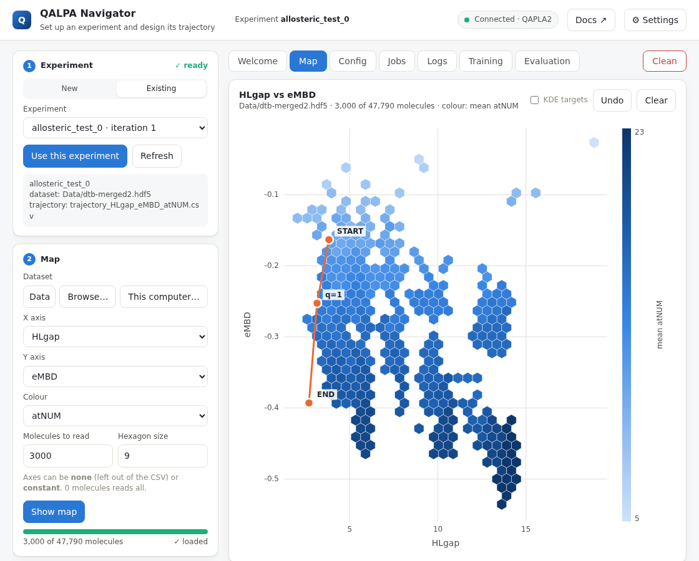

<h1 align="center">QALPA</h1>

<p align="center">
  <b>Quantum-Aware Learning for Property-Space Augmentation</b>
</p>

<p align="center">
  <a href="https://arxiv.org/abs/2609.16527"></a>
  <a href="https://qalpa.readthedocs.io/en/latest/"></a>
  <a href="LICENSE"></a>
  
  
</p>

<p align="center">
  <picture>
    <source media="(prefers-color-scheme: dark)" srcset="img/qalpa-workflow-dark.png">
    
  </picture>
</p>

QALPA steers a property-conditioned diffusion model through chemical space with quantum-mechanical feedback. You draw a **trajectory** through a quantum-mechanical (QM) property space, such as HOMO–LUMO gap and many-body dispersion energy, on top of an initial dataset. QALPA then walks it one iteration at a time: an equivariant diffusion model (EQDIFF) generates molecules at targets planned by **kernel density estimation (KDE)**, QM calculations verify them, and the verified molecules join the training data before the model is fine-tuned for the next step.

📖 **Full documentation: [qalpa.readthedocs.io](https://qalpa.readthedocs.io/en/latest/)**

## Features

- **Property-guided generation:** 3D molecules from an equivariant diffusion model, conditioned on QM properties and atom count.
- **KDE-planned active learning:** each iteration adds targets in sparse regions around the current waypoint.
- **QM labelling:** geometry optimization and properties with EquiDTB (machine-learned), DFTB+ or FHI-aims (DFT).
- **Quality control:** deduplication, QED/SA screening, and a check that each molecule hits the target it was generated for.
- **Continual learning:** fine-tuning on a weighted replay of all iterations' data, to limit forgetting.
- **Built for HPC:** split GPU/CPU SLURM jobs, Hydra configuration, restart from any step, and the **Navigator** browser app to design trajectories and run jobs.

## How it works

Each iteration is one forward job on a GPU, followed by one backward job on CPUs:

| Job | Steps |
|---|---|
| **Forward** (GPU) | `split` → `train` → `plan` (KDE targets) → `generate` → `dedup` |
| **Backward** (CPU) | `score_filter` (QED/SA) → `relax_geo` → `prop_calc` → `prop_filter` (hit or miss) → `hdf5` |

The backward job adds the verified molecules to the dataset and advances the iteration counter. See [How it works](https://qalpa.readthedocs.io/en/latest/user-guide/how-it-works.html) and [KDE target planning](https://qalpa.readthedocs.io/en/latest/user-guide/kde-planning.html).

## Installation

Requirements: a Linux cluster with SLURM (a GPU and a CPU partition) and Mamba or Conda. FHI-aims is optional and licensed separately.

```bash
git clone https://github.com/lmedranos/qalpa.git
cd qalpa

mamba env create -f environment_f.yml -p conda_envs/env-qalpa-forward/    # GPU: diffusion model
mamba env create -f environment_b.yml -p conda_envs/env-qalpa-backward/   # CPU: QM and screening

# Patch ASE's DFTB+ calculator in the CPU environment
cp src/dftb.py conda_envs/env-qalpa-backward/lib/python3.10/site-packages/ase/calculators/dftb.py
```

See [Installation](https://qalpa.readthedocs.io/en/latest/getting-started/installation.html) for the single-environment setup.

## Quick start

You need an initial dataset in AQM/QM7-X HDF5 format, with `atNUM`, `atXYZ` and the properties to condition on. Run QALPA from the Navigator app in your browser, or from the command line.

### Option 1: Navigator (browser app)

<p align="center">
  <picture>
    <source media="(prefers-color-scheme: dark)" srcset="img/navigator-app-dark.png">
    
  </picture>
</p>

The Navigator runs the whole workflow from one page: create an experiment, draw the trajectory on a map of your dataset, review the configuration, then submit and chain the SLURM jobs and follow training and results. Start its server on a login node:

```bash
pip install --user numpy h5py pyyaml paramiko   # once; or use a QALPA conda environment
python Navigator/navigator_server.py
```

Open the link it prints. VS Code forwards the port for you; otherwise run `ssh -L 8765:localhost:8765 <login-node>` on your computer first. Then work through steps 1 to 6 in the left panel. To submit jobs on a second cluster, the server needs an SSH key: see [Navigator setup](https://qalpa.readthedocs.io/en/latest/navigator/index.html).

### Option 2: Command line

1. **Get a trajectory:** use the example `Navigator/trajectory_HLgap_eMBD_atNUM.csv`, or draw one in the Navigator and download it as CSV.
2. **Create an experiment:**

   ```bash
   python src/scripts/init_experiment.py --name my_exp --dataset-path /path/to/initial_dataset.hdf5
   cp Navigator/trajectory_HLgap_eMBD_atNUM.csv Experiments/my_exp_0/configs/
   ```

3. **Review** `Experiments/my_exp_0/configs/experiment_config.yaml`, and set your cluster's partition, account and modules in the job scripts in `Experiments/my_exp_0/jobs/`.
4. **Run one iteration:**

   ```bash
   cd Experiments/my_exp_0/jobs
   fwd=$(sbatch --parsable qalpa_forward.sh)
   sbatch --dependency=afterok:$fwd qalpa_backward.sh
   ```

5. **Inspect the results** in `Data/my_exp_0/iter_<n>/`, starting with `targets.json` (what was requested) and `prop_filter_report.json` (what was hit).

The [Quick start guide](https://qalpa.readthedocs.io/en/latest/getting-started/quickstart.html) explains each step, including running the two jobs on different clusters.

## Documentation

| Section | Contents |
|---|---|
| [Getting started](https://qalpa.readthedocs.io/en/latest/getting-started/installation.html) | Installation and a first experiment |
| [User guide](https://qalpa.readthedocs.io/en/latest/user-guide/how-it-works.html) | The active-learning loop, KDE planning, SLURM, outputs, restarts, MLflow |
| [Configuration](https://qalpa.readthedocs.io/en/latest/configuration/index.html) | How settings are combined, every key with its default, and recipes |
| [Navigator](https://qalpa.readthedocs.io/en/latest/navigator/index.html) | Browser app to design trajectories, edit the config and run jobs |

## Citation

If you use QALPA, please cite:

```bibtex
@article{qalpa,
  title   = {QALPA: Property-guided diffusion modeling for efficient exploration of chemical spaces of flexible molecules},
  author  = {Michael Hanna and Julian Cremer and Zekiye Erarslan and Leonardo Medrano Sandonas},
  year    = {2026},
  journal = {arXiv preprint arXiv:2609.16527},
  url     = {https://arxiv.org/abs/2609.16527}
}
```

## License and contact

QALPA is released under the [MIT License](LICENSE). For questions, bug reports and feature requests, please open an [issue](https://github.com/lmedranos/qalpa/issues).
