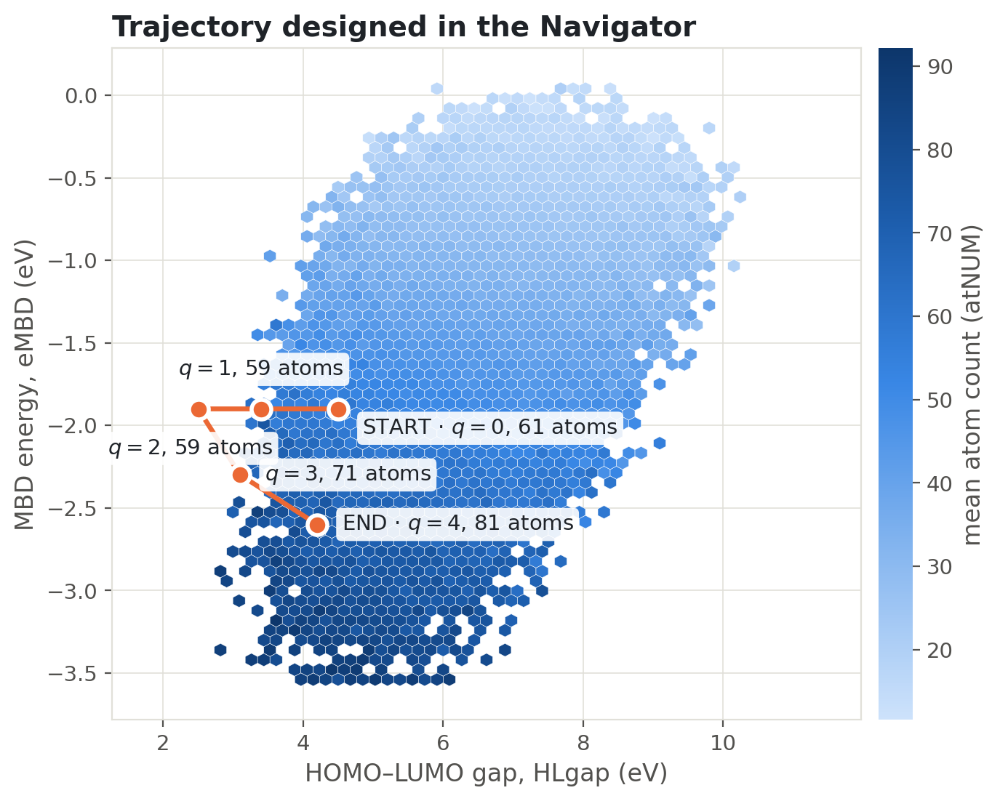
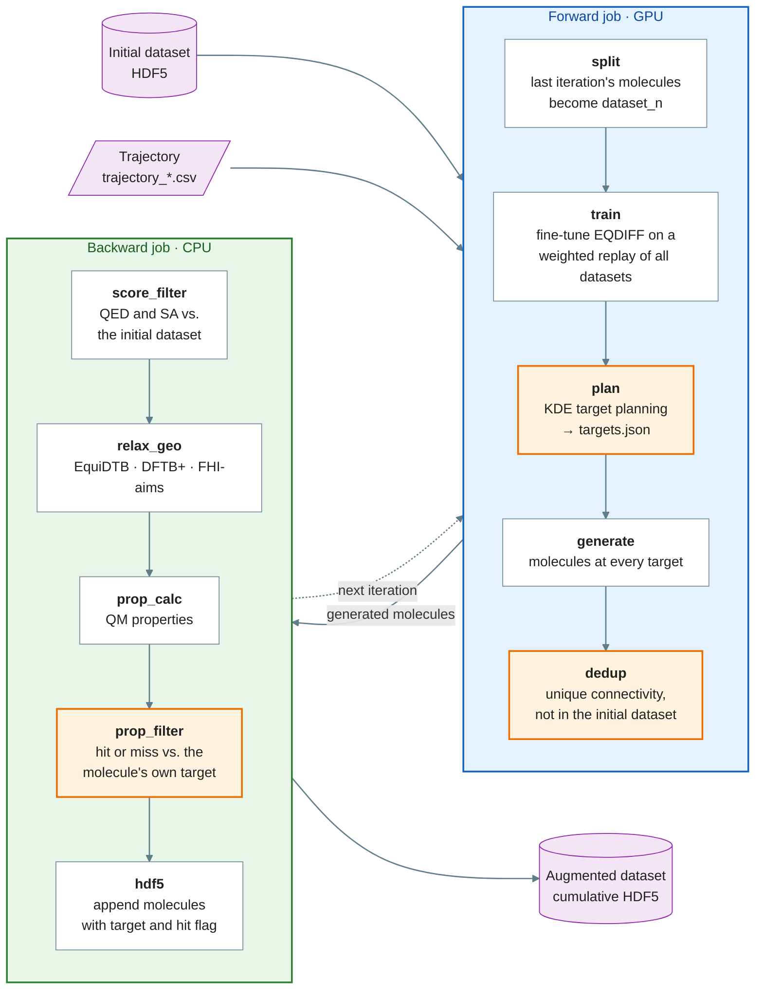
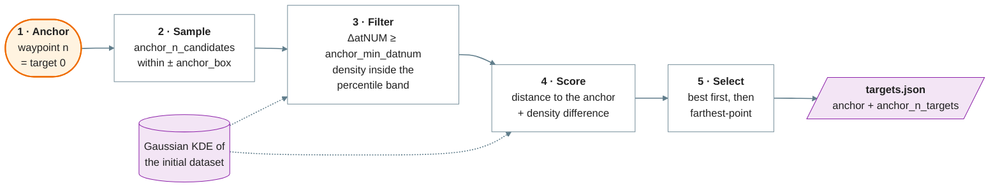

<h1 align="center">QALPA</h1>

<p align="center">
  <b>Quantum-Aware Learning for Property-Space Augmentation</b>
</p>

<p align="center">
  <a href="https://arxiv.org/abs/2609.16527"></a>
  <a href="LICENSE"></a>
  
  
</p>

<p align="center">
  Steer a property-conditioned diffusion model through chemical space with quantum-mechanical feedback<br/>
  and active learning planned by kernel density estimation.
</p>

<p align="center">
  <picture>
    <source media="(prefers-color-scheme: dark)" srcset="img/qalpa-workflow-dark.png">
    
  </picture>
</p>

## Table of contents

- [About QALPA](#about-qalpa)
- [How it works](#how-it-works)
  - [The active-learning loop](#the-active-learning-loop)
  - [KDE target planning](#kde-target-planning)
  - [Planning strategies](#planning-strategies)
- [Installation](#installation)
- [Quick start](#quick-start)
- [Running on SLURM](#running-on-slurm)
- [Configuration](#configuration)
- [Outputs](#outputs)
- [Resuming and re-planning](#resuming-and-re-planning)
- [Monitoring training with MLflow](#monitoring-training-with-mlflow)
- [Repository layout](#repository-layout)
- [Citation](#citation)
- [Contact and license](#contact-and-license)

## About QALPA

A conditional generative model is most reliable where its training data is dense. QALPA widens that region step by step. You draw a **trajectory** through a quantum-mechanical (QM) property space, for example HOMO–LUMO gap, many-body dispersion (MBD) energy and molecule size, on top of an initial dataset. QALPA then walks the trajectory one iteration at a time: an equivariant diffusion model (EQDIFF) generates molecules at property targets, QM calculations verify them, and the verified molecules join the training data before the model is fine-tuned for the next step.

The targets of every iteration are planned with **kernel density estimation (KDE)**. Besides the current waypoint, QALPA places additional targets nearby where the initial dataset is sparse and spreads them apart, so each iteration adds the data the model lacks most. Every labelled molecule records the target it was generated for and whether it hit it.

| Feature | What QALPA provides |
|---|---|
| **Property-guided generation** | 3D molecules from an equivariant diffusion model conditioned on QM properties and atom count |
| **KDE-planned active learning** | Per-iteration targets in sparse regions around each waypoint, scored with a Gaussian KDE of the initial dataset and spread out by farthest-point selection |
| **QM labelling** | Geometry optimization and properties with EquiDTB (machine-learned), DFTB+, or FHI-aims (DFT) |
| **Quality control** | Connectivity-based deduplication, QED/SA screening against the initial dataset, per-target property-accuracy filter |
| **Continual learning** | Fine-tuning on a weighted replay of the initial data and every iteration's new molecules |
| **HPC-ready and traceable** | Split GPU/CPU SLURM jobs, Hydra configuration, restart from any block; targets, hits and reports stored per iteration |

## How it works

QALPA runs in three phases.

| Phase | What you do | Tool |
|---|---|---|
| **I · Trajectory design** | Draw waypoints through property space on top of the initial dataset and export them as `trajectory_*.csv` | [`Navigator/design_trajectory.ipynb`](Navigator/design_trajectory.ipynb) |
| **II · Active-learning loop** | Run one forward (GPU) and one backward (CPU) job per iteration | [`forward.py`](src/scripts/forward.py), [`backward.py`](src/scripts/backward.py) |
| **III · Analysis** | Inspect targets, hit rates, molecules and training curves | `Data/<experiment>/`, [`analysis/`](analysis/), MLflow |

<p align="center">
  <picture>
    <source media="(prefers-color-scheme: dark)" srcset="img/navigator-trajectory-dark.png">
    
  </picture><br/>
  <sub>Phase I: waypoints drawn in the Navigator on the HLgap–eMBD map of the initial dataset, coloured by atom count.</sub>
</p>

### The active-learning loop

Each iteration *n* is one **forward** job on a GPU followed by one **backward** job on CPUs. Orange blocks belong to active learning (`plan`, `dedup`) or change behaviour with it (`prop_filter`).



| # | Block | Job | What happens | Written to `Data/<experiment>/` |
|:-:|---|:-:|---|---|
| 1 | `split` | Forward | The molecules labelled in iteration *n − 1* become dataset `dataset_n` (iteration 0: the initial dataset) and are split into train, validation and test sets | `diffusion_wdir/data/dataset_<n>/` |
| 2 | `train` | Forward | EQDIFF is fine-tuned from the previous checkpoint on a weighted replay of all datasets | `diffusion_wdir/model_registry/model_iter_<n>/` |
| 3 | `plan` | Forward | The KDE planner chooses this iteration's targets ([details](#kde-target-planning)) | `iter_<n>/targets.json` |
| 4 | `generate` | Forward | Molecules are generated at every target, conditioned on its properties and atom count | `iter_<n>/generated/t<id>/` |
| 5 | `dedup` | Forward | Molecules with identical connectivity, or already in the initial dataset, are removed | `iter_<n>/dedup_report.csv` |
| 6 | `score_filter` | Backward | Molecules are screened against the initial dataset's mean QED and SA score (`query.score_relax` sets the margin) | `iter_<n>/score_filtered/` |
| 7 | `relax_geo` | Backward | Geometries are optimized with EquiDTB, DFTB+ or FHI-aims | `iter_<n>/relaxed/` |
| 8 | `prop_calc` | Backward | QM properties are computed | `iter_<n>/prop_calc/` |
| 9 | `prop_filter` | Backward | Each molecule is labelled *hit* or *miss* against **the target it was generated for**; misses are dropped | `iter_<n>/prop_filter_report.json` |
| 10 | `hdf5` | Backward | Labelled molecules are appended, with their target and hit flag, to the cumulative dataset and saved as the next iteration's dataset | `hdf5/<name>-output.hdf5`, `iter_<n>/hdf5/` |

At the end of the backward job, `loop.current_iter` is advanced in `experiment_config.yaml`, so the next forward job continues with iteration *n + 1*. Add `evaluate` after `hdf5` in `pipeline.blocks` to also log each iteration's hit rate and coverage to `Experiments/<experiment>/al_metrics.csv`.

### KDE target planning

The `plan` block decides *where* the model is asked to generate. With the template settings (`query_strategy: kde_map`, `kde_region: anchor`, `anchor_score: relative_pct`), it builds each iteration's targets in five steps.



1. **Anchor.** Target 0 is waypoint *n* of the trajectory and receives `EQdiffParam.num_samples` molecules. When there are more iterations than waypoints, the last waypoint is reused.
2. **Sample.** `anchor_n_candidates` candidate targets are drawn uniformly within ± `anchor_box` (a fraction of each anchor value) on every planning axis: the conditioning properties plus `atNUM`.
3. **Filter.** A candidate is eligible if its atom count differs from the anchor's by at least `anchor_min_datnum` and its KDE density lies inside the `density_percentiles` band of the initial dataset. The template band, the 5th to 15th percentile, selects regions that are sparse but not empty. If too few candidates qualify, the planner adds those closest to the band.
4. **Score.** Each eligible candidate **y** is scored by how far it lies from the anchor **a**, both in property values and in density:

   ```math
   s(\mathbf{y}) \;=\; \sum_{k} 100\,\frac{\lvert y_k - a_k\rvert}{\lvert a_k\rvert} \;+\; 100\,\frac{\lvert \hat p(\mathbf{y}) - \hat p(\mathbf{a})\rvert}{\hat p(\mathbf{a})}
   ```

   Here *k* runs over the conditioning properties and *p̂* is the KDE of the initial dataset.
5. **Select.** The highest-scoring candidate is taken first. Every further target is the eligible candidate farthest from all targets chosen so far, anchor included (farthest-point sampling in relative-% space). The planner selects `anchor_n_targets` targets, and each receives `anchor_extra_fraction × num_samples` molecules.

With the template values, each iteration requests 200 molecules at the waypoint and 40 at each of two KDE targets, 280 in total.

The KDE is a Gaussian kernel density estimate of the initial dataset in standardized property space (Scott bandwidth, at least one atom wide along `atNUM`). Its leave-one-out densities define the percentile band; they are computed once and cached in `Experiments/<experiment>/density_reference.npy`. Because the reference is the initial dataset, KDE planning starts in iteration 0, and it is deterministic for a given `system.seed`. Every candidate, with its score components and selection order, is listed in `iter_<n>/anchor_candidates.csv`.

**Closing the loop.** After the QM step, each molecule is judged against its own target **t**. It is a *hit* if every conditioning property lies within tolerance; atom count is not part of the rule:

```math
\lvert y_k - t_k\rvert \;\le\; \max\!\left(\varepsilon^{\mathrm{rel}}_k\,\lvert t_k\rvert,\; \varepsilon^{\mathrm{abs}}_k\right) \qquad \text{for every conditioning property } k
```

The relative tolerance defaults to `query.filter_threshold` (0.1) and the absolute tolerance to 0; both can be set per property in `al.tolerances`. `prop_filter` removes the misses but keeps their statistics in `prop_filter_report.json`. Without `prop_filter`, misses are stored with `al_hit = 0`.

### Planning strategies

`al.query_strategy` and `al.kde_region` select how targets are planned.

| Strategy | Settings | Targets per iteration | Typical use |
|---|---|---|---|
| **KDE anchor** (template) | `kde_map` + `kde_region: anchor` | Waypoint *n* plus `anchor_n_targets` KDE targets around it | Follow the trajectory and fill sparse neighbourhoods |
| **KDE corridor** | `kde_map` + `kde_region: corridor` | `targets_per_iter` targets inside a padded corridor around the whole trajectory | Explore the full path adaptively |
| **Frontier** | `frontier` | One waypoint, advanced once its hit rate reaches `advance_hit_rate` | Strictly sequential navigation |
| **Trajectory** | `trajectory` | Waypoint *n* | Baseline with active-learning bookkeeping |
| **No active learning** | `al.enabled: false` | Waypoint *n*; `plan` and `dedup` are skipped | The original, non-adaptive pipeline |

The corridor mode, and the anchor mode with `anchor_score: kde`, rank candidates by an adaptive score built from the data and the generator's track record:

```math
s(\mathbf{y}) \;=\; w_{\mathrm{sparse}}\,\mathrm{norm}\!\left[-\log \hat p_{\mathrm{lab}}(\mathbf{y})\right] \;+\; w_{\mathrm{err}}\,\mathrm{norm}\!\left[\bar e(\mathbf{y})\right] \;+\; \frac{w_{\mathrm{explore}}}{\sqrt{n_{\mathrm{eff}}(\mathbf{y}) + 1}}
```

Here *p̂*<sub>lab</sub> is a KDE of all labelled molecules, *ē* is the generator's kernel-smoothed past error near **y**, *n*<sub>eff</sub> counts past requests near **y**, and norm rescales to [0, 1]. Regions the generator has repeatedly failed to reach (`density.min_reach`, `min_neff`) are skipped, and a Gaussian repulsion keeps the targets apart. The corridor mode needs this track record, so it requests the plain waypoint until the molecules of a first iteration have been labelled.

## Installation

### Requirements

- A Linux cluster with SLURM, a GPU partition (forward job) and a CPU partition (backward job)
- Mamba or Conda
- FHI-aims as an HPC module, only if you use it (licensed separately). DFTB+ is installed with the environments, and the EquiDTB model ships in `src/configs/`.

QALPA uses two environments: a GPU environment for the diffusion model and a CPU environment for QM and screening. A single combined environment is available for development.

### Split environments (recommended)

```bash
git clone https://github.com/lmedranos/qalpa.git
cd qalpa

# GPU: diffusion training and generation
mamba env create -f environment_f.yml -p conda_envs/env-qalpa-forward/

# CPU: geometry optimization, QM, screening
mamba env create -f environment_b.yml -p conda_envs/env-qalpa-backward/

# Patch ASE's DFTB+ calculator in the CPU environment
ASE_DFTB=conda_envs/env-qalpa-backward/lib/python3.10/site-packages/ase/calculators/dftb.py
cp "$ASE_DFTB" "$ASE_DFTB.bak"
cp src/dftb.py "$ASE_DFTB"
```

The job templates activate exactly these two paths, and the backward job points `DFTB_PREFIX` to the bundled Slater–Koster files. For interactive DFTB+ runs, export it yourself:

```bash
export DFTB_PREFIX="$PWD/src/configs/SKfiles/3ob-3-1/"
```

<details>
<summary><b>Combined environment (development, single machine)</b></summary>

```bash
mamba env create -f environment-al.yml -p conda_envs/env-activeloop/
```

Apply the same ASE patch inside `conda_envs/env-activeloop/`, then change the `conda activate` line of both job scripts to:

```bash
conda activate $REPO_ROOT/conda_envs/env-activeloop
```

</details>

## Quick start

You need an initial dataset in AQM/QM7-X HDF5 format: molecule groups with `atNUM`, `atXYZ` and the properties you want to condition on (for example `HLgap` and `eMBD`).

### 1. Design a trajectory

Open [`Navigator/design_trajectory.ipynb`](Navigator/design_trajectory.ipynb) and set `file_path` to your initial dataset. Choose the x, y and colour properties, for example `HLgap`, `eMBD` and `atNUM`, and press **Show Plot**. Left-click the waypoints from start to end (**Undo** and **Clear** correct mistakes). Each click snaps to the nearest hexagon and records its mean colour value, so with `atNUM` as the colour every waypoint also gets an atom count. **Save Plot + CSV** writes `trajectory_<x>_<y>_<colour>.csv`.

**No Jupyter?** Use the Navigator app in your browser. On the cluster, in a VS Code terminal, run:

```bash
python Navigator/navigator_server.py      # any QALPA conda environment
```

and open the link it prints (VS Code forwards the port; without VS Code, run `ssh -L 8765:localhost:8765 <login-node>` on your computer). The app walks you through four steps: **1 Experiment** creates a new experiment (it runs `init_experiment.py` with the name and dataset you choose) or opens an existing one; **2 Map** reads the molecules when you press **Show map**; **3 Waypoints** are added by clicking the map; **4 Save to experiment** writes the trajectory into `Experiments/<experiment>/configs/` (older `trajectory_*.csv` files there are renamed to `.bak`) and sets `EQdiffParam.properties_list` in that experiment's config. The server listens only on localhost and needs the token it prints: if the page asks, paste it once and the browser remembers it. It reads and writes only inside the project folder (`--root`, or **⚙ Settings** in the app). To run the app on your own computer instead, `pip install numpy h5py paramiko`, start the same script there, and enter your HPC host, user and SSH key under **⚙ Settings**. Without a server, double-click [`Navigator/navigator.html`](Navigator/navigator.html) to use the same app on files from your own computer. The full guide, including job submission from the app, is in [`Navigator/README.md`](Navigator/README.md).

To try QALPA first, use the example [`Navigator/trajectory_HLgap_eMBD_atNUM.csv`](Navigator/trajectory_HLgap_eMBD_atNUM.csv):

```csv
HLgap,eMBD,atNUM,SAScore
4.5,-1.9,61,5.0
3.4,-1.9,59,5.0
2.5,-1.9,59,5.0
3.1,-2.3,71,5.0
4.2,-2.6,81,5.0
```

Each row is one waypoint. The file needs one column per conditioning property, named as in `EQdiffParam.properties_list`, and an `atNUM` column with the atom count, which the template's `relative_pct` planner requires. Score columns such as `SAScore` are read only with `query.score_reference: trajectory`. With active learning, iterations beyond the last row reuse it; without it, provide one row per iteration.

### 2. Initialize an experiment

```bash
python src/scripts/init_experiment.py --name my_exp --dataset-path /path/to/initial_dataset.hdf5
cp Navigator/trajectory_HLgap_eMBD_atNUM.csv Experiments/my_exp_0/configs/
```

```text
Experiments/my_exp_0/
├── configs/experiment_config.yaml   # experiment settings, paths already filled in
├── jobs/qalpa_forward.sh            # GPU job: split → train → plan → generate → dedup
├── jobs/qalpa_backward.sh           # CPU job: score_filter → relax_geo → prop_calc → prop_filter → hdf5
├── logs/
└── results/
```

Experiment names are versioned: running the command again creates `my_exp_1`. Keep exactly one `trajectory_*.csv` in `configs/`; if several match, the first in alphabetical order is used.

### 3. Review the configuration

The template in `Experiments/my_exp_0/configs/experiment_config.yaml` runs KDE-planned active learning as it is. Check at least:

| Setting | Why it matters |
|---|---|
| `EQdiffParam.properties_list` | Conditioning properties; must match the trajectory columns |
| `loop.num_iterations` | Iterations run from 0 up to this value |
| `geometry.optimizer`, `properties.calculator` | `EquiDTB` (template default), `DFTB+` or `FHI-aims` (also set `system.fih_aims_exc` in `global_config.yaml`) |
| `EQdiffParam.num_samples` | Molecules generated at the waypoint per iteration |
| `al.*` | How targets are planned, see [Configuration](#configuration) |
| `mlflow.*` | Optional training dashboards, see [MLflow](#monitoring-training-with-mlflow) |

### 4. Adapt the job scripts

Set the partition, time limit, account, conda path and modules for your cluster, as described in [Running on SLURM](#running-on-slurm).

### 5. Submit

One iteration is a forward job followed by a backward job. The backward job must start only after the forward job of the same iteration has finished successfully: it works on the generated molecules, and it is the backward job that advances `loop.current_iter` for the next forward job. Both jobs share state only through the experiment folders, so the GPU and CPU partitions may belong to different clusters as long as both mount the same file system.

**Forward and backward on different clusters (manual).** SLURM dependencies do not work across separate clusters, so submit each job yourself and wait for it to finish:

```bash
cd Experiments/my_exp_0/jobs

# on the GPU cluster
sbatch qalpa_forward.sh
# wait until it has finished: squeue -u $USER is empty and logs/fcheck-log.out ends with "Forward Job completed"

# on the CPU cluster
sbatch qalpa_backward.sh
# wait until logs/bcheck-log.out ends with "Backward Job completed"; loop.current_iter has advanced

# repeat both steps for the next iteration
```

> [!WARNING]
> Never run the forward job of the next iteration while the backward job is still running. The forward job would read the old `loop.current_iter` and run the same iteration again.

**Both partitions on one cluster (chained).** The forward and backward jobs of one iteration can be linked with a dependency:

```bash
cd Experiments/my_exp_0/jobs
fwd=$(sbatch --parsable qalpa_forward.sh)
sbatch --dependency=afterok:$fwd qalpa_backward.sh
```

To queue the whole run at once, chain the pairs. Each job reads `loop.current_iter` when it starts, and each backward job advances it:

```bash
prev=""
for n in $(seq 0 8); do                      # iterations 0 … loop.num_iterations
  fwd=$(sbatch --parsable ${prev:+--dependency=afterok:$prev} qalpa_forward.sh)
  prev=$(sbatch --parsable --dependency=afterok:$fwd qalpa_backward.sh)
  echo "iteration $n: forward $fwd, backward $prev"
done
```

If a job fails, the jobs queued after it cannot start (`DependencyNeverSatisfied`). Cancel them with `scancel`, fix the cause, and [resume](#resuming-and-re-planning).

### 6. Monitor

```bash
squeue -u $USER
tail -f Experiments/my_exp_0/logs/fcheck-log.out    # forward job
tail -f Experiments/my_exp_0/logs/bcheck-log.out    # backward job
```

The results of iteration *n* appear in `Data/my_exp_0/iter_<n>/`. Start with `targets.json` (what was requested) and `prop_filter_report.json` (what was hit).

## Running on SLURM

`init_experiment.py` copies both job scripts from `Experiments/templates/jobs/` and fills in the repository and experiment paths. Edit the templates once, and every new experiment inherits your cluster settings.

| | Forward: `qalpa_forward.sh` | Backward: `qalpa_backward.sh` |
|---|---|---|
| Blocks | `split` → `train` → `plan` → `generate` → `dedup` | `score_filter` → `relax_geo` → `prop_calc` → `prop_filter` → `hdf5` |
| Template resources | 1 node, 1 GPU, 6 CPUs, 8000 MB per CPU | 10 nodes × 32 tasks, 6000 MB per CPU |
| Template partition and time | `capella`, 20 h | `barnard`, 5 h |
| Environment | `conda_envs/env-qalpa-forward` | `conda_envs/env-qalpa-backward` and the FHI-aims modules |
| Log | `logs/fcheck-log.out`, `logs/fcheck-log.err` | `logs/bcheck-log.out`, `logs/bcheck-log.err` |

Adapt these lines in both scripts before the first run:

```bash
#SBATCH --partition=<partition>          # GPU partition (forward) or CPU partition (backward)
#SBATCH --time=HH:MM:SS
#SBATCH --mail-user=<you@institution>    # or delete the two mail lines
#SBATCH -A <account>                     # add if your cluster requires an account

source <conda-install>/etc/profile.d/conda.sh   # replaces the site-specific Anaconda path
```

In the backward script, replace the module line with your cluster's equivalents (the template loads the compiler, MPI and FHI-aims modules). If you use FHI-aims, also set `system.fih_aims_exc` in `global_config.yaml` to your `aims.x`:

```bash
module load <release> <compiler> <mpi> <fhi-aims-module>
```

The backward job runs up to `max_parallel_tasks` relaxations or QM calculations at a time (template: 20), each limited to `processing_timeout_hours` (template: 2).

## Configuration

QALPA composes its configuration with Hydra. Later sources override earlier ones:

| Priority | Source | Holds |
|:-:|---|---|
| 1 (lowest) | [`global_config.yaml`](global_config.yaml) | Shared paths, seed, FHI-aims executable |
| 2 | [`src/configs/src_paths.yaml`](src/configs/src_paths.yaml), [`src/configs/eqdiff_model.yaml`](src/configs/eqdiff_model.yaml) | Code paths; diffusion-model architecture and optimizer |
| 3 | `Experiments/<experiment>/configs/experiment_config.yaml` | Everything specific to your experiment |
| 4 (highest) | `key=value` arguments to `forward.py` or `backward.py` | Overrides for a single job |

Any `al.*` key you leave out falls back to [`src/configs/al.yaml`](src/configs/al.yaml). Settings are checked when a job starts, and inconsistent combinations, such as `anchor_score: relative_pct` without an `atNUM` column, stop the job with a clear message.

> [!NOTE]
> Every backward job writes the complete composed configuration back to `experiment_config.yaml`, together with the advanced `loop.current_iter`. After the first iteration, change shared settings such as paths or the FHI-aims executable in the experiment's own `experiment_config.yaml`; overrides given to a backward job stay in effect.

Every key, with its default, its effect and when to change it, is documented in [CONFIGURATION_REFERENCE.md](CONFIGURATION_REFERENCE.md).

The tables list the keys you are most likely to change, with their template values.

**Loop and pipeline**

| Key | Template | Meaning |
|---|---|---|
| `loop.num_iterations` | `8` | Iterations run from 0 up to this value |
| `loop.current_iter` | `0` | Iteration the next job runs; advanced by every backward job |
| `pipeline.blocks` | all blocks | Blocks to run, in order. Remove `prop_filter` to keep misses; add `evaluate` after `hdf5` for `al_metrics.csv` |
| `pipeline.start_at` | `split` | First block to run, used for restarts |

**Generation and training** (`EQdiffParam`)

| Key | Template | Meaning |
|---|---|---|
| `properties_list` | `[HLgap, eMBD]` | Conditioning properties. Active learning supports `HLgap`, `eMBD`, `DIP`, `eH` and `eL` |
| `num_samples` | `200` | Molecules generated at the waypoint per iteration |
| `num_epochs` | `50` | Training epochs per iteration |
| `test_interval` | `25` | Epochs between sampling evaluations; `best_mol_stab.ckpt` is saved only at these points |
| `load_ckpt_from_pretrained` | `null` | Optional checkpoint for iteration 0 |
| `concat_datasets` | `true` | Keep one dataset per iteration and train on all of them (needs `hdf5.hdf5_iter_flag: True`) |
| `alpha`, `beta` | `0.6`, `0.9` | Sampling shares: the newest dataset gets 1 − α; the older ones share α, with the initial dataset weighted β relative to each intermediate one |
| `min_original_share` | `0.1` | Lower bound for the initial dataset's share, to limit forgetting |
| `samples_per_epoch` | `1000` | Draws per epoch once more than one dataset exists |

**QM labelling and screening**

| Key | Template | Meaning |
|---|---|---|
| `geometry.optimizer` | `EquiDTB` | `EquiDTB`, `DFTB+` or `FHI-aims` |
| `properties.calculator` | `EquiDTB` | `EquiDTB`, `DFTB+` or `FHI-aims` |
| `geometry.model`, `properties.model` | `MACE_model_swa.model` | EquiDTB model in `src/configs/` |
| `query.score_reference` | `initial_mean` | QED and SA thresholds from the initial dataset's means; `trajectory` reads per-waypoint thresholds from the CSV |
| `query.score_relax` | `QED: 0.2`, `SAScore: 0.2` | A molecule passes if QED > (1 − r) × mean QED and SA < (1 + r) × mean SA; r > 0 loosens, r < 0 tightens |
| `query.filter_scheme` | `[score, accuracy]` | `score` enables `score_filter`, `accuracy` enables `prop_filter` |
| `query.filter_threshold` | `0.1` | Default relative tolerance of the hit rule |

**Active learning** (`al`)

| Key | Template | Meaning |
|---|---|---|
| `enabled` | `true` | Switch KDE-planned active learning on or off |
| `query_strategy` | `kde_map` | `kde_map`, `frontier` or `trajectory` ([strategies](#planning-strategies)) |
| `kde_region` | `anchor` | `anchor` (box around the waypoint) or `corridor` (whole trajectory) |
| `anchor_box` | `0.1` | Half-width of the candidate box, as a fraction of each anchor value |
| `anchor_n_candidates` | `200` | Candidates sampled in the box |
| `anchor_n_targets` | `2` | Additional targets per iteration |
| `anchor_score` | `relative_pct` | `relative_pct` (distance and density difference) or `kde` (adaptive score) |
| `anchor_min_datnum` | `1` | Minimum atom-count difference between a KDE target and the anchor (`relative_pct`) |
| `anchor_extra_fraction` | `0.2` | Molecules per additional target, as a fraction of `num_samples`; `null` divides `num_samples` among all targets |
| `density.density_percentiles` | `[5.0, 15.0]` | Density band for eligible candidates, in percentiles of the initial dataset; `null` disables it |
| `density.bandwidth` | `scott` | KDE bandwidth: Scott's rule or a number in standardized units |
| `tolerances` | `default: {relative: null, absolute: 0.0}` | Hit tolerances, globally or per property (for example `HLgap: {relative: 0.05}`); `null` means `query.filter_threshold` |
| `dedup` | `enabled: true`, `scope: all`, `against_initial: true` | Remove duplicates across all targets (`target`: within each) and molecules already in the initial dataset |
| `keep_off_target` | `true` | Without `prop_filter`: store misses with `al_hit = 0` instead of dropping them |
| `generation_budget_hours` | `6` | Skip the remaining targets once generation has used this much wall time |

**Data**

| Key | Template | Meaning |
|---|---|---|
| `hdf5.appending_flag` | `True` | Accumulate labels in the cumulative HDF5 (required for active learning) |
| `hdf5.hdf5_iter_flag` | `True` | Write each iteration's molecules to `iter_<n>/hdf5/output.hdf5` (required by `concat_datasets`) |

## Outputs

```text
Data/my_exp_0/
├── hdf5/
│   ├── <name>-input.hdf5            # copy of the initial dataset: KDE, QED/SA and dedup reference
│   └── <name>-output.hdf5           # cumulative dataset: initial molecules + every labelled molecule
├── diffusion_wdir/
│   ├── data/dataset_<k>/            # train/validation/test split of each dataset
│   └── model_registry/model_iter_<n>/    # checkpoints: best_mol_stab.ckpt, run0/last.ckpt
└── iter_<n>/
    ├── targets.json                 # planned targets and their metadata
    ├── anchor_candidates.csv        # every candidate: score components, eligibility, selection order
    ├── generated/t<id>/             # raw molecules per target
    ├── dedup_report.csv             # every molecule: kept, duplicate or in_initial
    ├── score_filtered/              # QED/SA scores (scores.tsv) and rejected molecules
    ├── relaxed/  prop_calc/         # optimized geometries and QM results
    ├── prop_filter_properties.csv   # requested vs. computed properties of every molecule
    ├── prop_filter_report.json      # hit rate per target, misses included
    ├── rejected/                    # removed molecules, reasons in reasons.json
    └── hdf5/output.hdf5             # this iteration's molecules, the next iteration's dataset

Experiments/my_exp_0/
├── al_state.json                    # planner state
├── density_reference.npy            # cached KDE reference densities of the initial dataset
└── al_metrics.csv                   # hit rate and coverage per iteration (with the evaluate block)
```

In the cumulative HDF5, each generated molecule carries `al_iteration`, `al_target_id`, `al_requested` (its target) and `al_hit` next to its properties, so every molecule can be traced back to the request that produced it.

For Phase III, the notebooks in [`analysis/`](analysis/) work on these outputs. Set the paths in each notebook's configuration cell first.

| Notebook | Use it to |
|---|---|
| [`iteration_analysis.ipynb`](analysis/iteration_analysis.ipynb) | Follow SA-score distributions and model-evaluation metrics across iterations, and compare experiments |
| [`augmented_data_analysis.ipynb`](analysis/augmented_data_analysis.ipynb) | Compare the property distributions of the initial and the augmented dataset (2D KDE) |
| [`accuracy_analysis.ipynb`](analysis/accuracy_analysis.ipynb) | Compare predicted and reference properties for the models of successive iterations |
| [`hdf5_analysis.ipynb`](analysis/hdf5_analysis.ipynb) | Inspect the structure and property distributions of any HDF5 dataset |

## Resuming and re-planning

`pipeline.start_at` restarts the current iteration (`loop.current_iter`) from any block; the blocks before it are skipped. An existing `targets.json` is always reused, and `split` keeps a dataset that is already prepared.

| Goal | Set in `experiment_config.yaml` | Then submit |
|---|---|---|
| Resume after a failed block | `pipeline.start_at: <failed block>` | The job that owns the block, then the remaining chain |
| Re-plan targets without retraining | Delete `iter_<n>/targets.json`; `pipeline.start_at: plan` | Forward, then backward |
| Regenerate for the same targets | `pipeline.start_at: generate` (reuses `targets.json`) | Forward, then backward |
| Redo the backward step without regenerating | `pipeline.start_at: dedup` (refills `query/` from the generated molecules) | Forward, then backward |

These restarts are meant for an iteration whose `hdf5` block has not run yet; after that, its molecules are already part of the cumulative dataset.

> [!IMPORTANT]
> `pipeline.start_at` is not reset automatically. Set it back to `split` once the restarted iteration has finished, or the next iteration will skip its first blocks.

To restart a single job without editing the config, set the block for that job only, in either of two ways:

- In the Navigator, use **Start at** in step 6 Run (see [Navigator/README.md](Navigator/README.md)).
- On the command line, set the environment variable `QALPA_START_AT`, for example `sbatch --export=ALL,QALPA_START_AT=prop_calc qalpa_backward.sh`.

The variable takes priority over `pipeline.start_at` for that job. The config is not changed, so the jobs after it run from `pipeline.start_at` (normally `split`) and nothing needs resetting.

## Monitoring training with MLflow

Training logs to TensorBoard. With `mlflow.enabled: true`, the forward job mirrors the logs of all iterations into an MLflow store after every training run. You can also sync by hand at any time, even while training runs:

```bash
python src/scripts/sync_mlflow.py \
  --model-root Data/my_exp_0/diffusion_wdir/model_registry \
  --tracking-uri file://$PWD/Data/mlruns --experiment my_exp_0
mlflow ui --backend-store-uri file://$PWD/Data/mlruns --port 5000
```

On a cluster, forward the port with `ssh -L 5000:localhost:5000 <login-node>`, or let VS Code forward it.

| Run | Contents |
|---|---|
| `iter_NN` | All training, validation and test curves of one iteration, per-dataset losses (`val_dataset_<k>/…`, `test_dataset_<k>/…`), sampling metrics (`gen/<metric>`: validity, QED, SA, …), hyperparameters and sampling shares |
| `overview` | One point per iteration: final metrics (`final/…`), sampling shares (`share/dataset_<k>`), draws per sample (`draws_per_sample_per_epoch/dataset_<k>`) and forgetting (`forgetting/dataset_<k>`), plus a test-loss matrix of every model on every test set |

<details>
<summary><b>Reading the curves</b></summary>

- A positive `forgetting/dataset_0`, or a rising `final/val_dataset_0/loss_epoch`, means the model is forgetting the initial data. Raise `min_original_share`, `alpha` or `beta`.
- A large `draws_per_sample_per_epoch` for the newest dataset means a risk of overfitting to it. Lower `samples_per_epoch` or raise `alpha`.
- The diffusion test loss is computed at random noise levels, so small changes between iterations are noise.

</details>

`mlflow.python` must point to an interpreter with `mlflow`, `tensorboard` and `matplotlib`; replace the template's site-specific path. `mlflow` is part of all three environment files. If your environment was created without it, use a small side environment so the training environment stays unchanged (`matplotlib` comes with `mlflow`):

```bash
conda_envs/env-qalpa-forward/bin/python -m venv conda_envs/env-qalpa-mlflow
conda_envs/env-qalpa-mlflow/bin/python -m pip install "mlflow<3" tensorboard
```

Then set `mlflow.python` to `<repo>/conda_envs/env-qalpa-mlflow/bin/python`.

## Repository layout

```text
qalpa/
├── Navigator/              # Phase I: trajectory designer and an example trajectory
├── Experiments/templates/  # experiment_config.yaml and the SLURM job templates
├── src/
│   ├── scripts/            # init_experiment, forward, backward, sync_mlflow
│   ├── pipeline_blocks/    # plan_targets, dedup_molecules, score_screen, optimize_geometry,
│   │                       # prop_calc, label_targets, to_hdf5, evaluate_targets, …
│   ├── utils/              # kde_plan, al_config, al_state, trajectory, data management, parallelization
│   ├── configs/            # al.yaml, eqdiff_model.yaml, src_paths.yaml, EquiDTB model, Slater–Koster files
│   └── eqdiff/             # equivariant diffusion model and weighted dataset concatenation
├── analysis/               # Phase III notebooks
├── Data/                   # experiment data, written at run time
├── global_config.yaml      # shared configuration
└── environment_f.yml, environment_b.yml, environment-al.yml
```

## Citation

If you use QALPA, please cite:

```bibtex
@article{qalpa,
  title   = {QALPA: Property-guided diffusion modeling for efficient exploration of chemical spaces of flexible molecules},
  author  = {Michael Hanna and Julian Cremer and Zekiye Erarslan and Leonardo Medrano Sandonas},
  year    = {2026},
  journal = {arXiv preprint arXiv:2609.16527},
  url     = {https://arxiv.org/abs/2609.16527}
}
```

## Contact and license

For questions, bug reports and feature requests, please open an [issue](https://github.com/lmedranos/qalpa/issues).

QALPA is released under the [MIT License](LICENSE).
