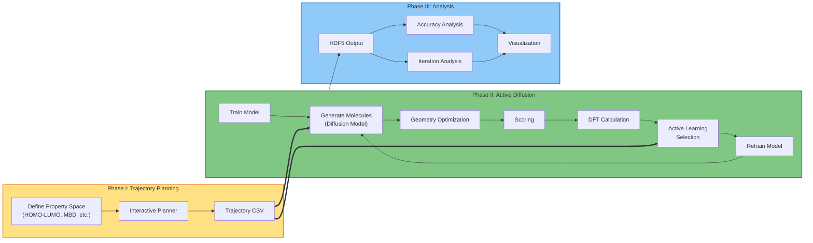
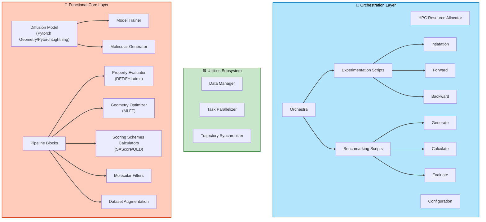

# EQMgen: QM Active Learning Diffusion for Molecular Design

[](LICENSE)
[](https://www.python.org/downloads/)

This model uses the Diffusion model and Density Functional Theory (DFT) through active learning to navigate chemical space and improve our generative model for molecular design.


## Overview

The EQMgen framework combines diffusion models with quantum mechanical calculations to generate novel molecules with desired properties. The system leverages active learning to iteratively improve molecular generation by incorporating DFT feedback, enabling efficient exploration of chemical space.

**Key Features:**
- Molecular trajectory planning in property space
- Iterative active learning with DFT feedback
- HPC-optimized workflow orchestration
- Comprehensive analysis and visualization tools
- Property-guided molecular generation

## WorkFlow

The software system is organized into a modular architecture that follows a three-phase workflow, guiding the process from molecular trajectory design to data analysis. 



### Phase I – Trajectory Planning

This phase provides an interactive environment for defining molecular trajectories within a property space (e.g., HOMO-LUMO gap, many-body dispersion energy, atomic number). The resulting trajectory files (`trajectory_*.csv`) serve as input for the active learning process. 


**Tools:** Interactive trajectory planner in the `trajectory/` directory

### Phase II – Active Diffusion Execution

This represents the core operational layer of the system, responsible for orchestrating the iterative molecular generation, evaluation, and feedback process. 


### Phase III – Output Analysis

The final phase focuses on analyzing and visualizing the output. Jupyter notebooks (`accuracy_analysis.ipynb`, `iteration_analysis.ipynb`, `hdf5_analysis.ipynb`) allow users to inspect the active diffusion results, model performance, and generated molecular properties.


## Active Diffusion Architecture

The architectural elements are organized as follows:

### Surface Layer – Experiment Orchestration Layer
Responsible for workflow coordination, configuration management, and resource allocation across HPC environments. It defines the experiment lifecycle.

### Deep Layer – Functional Core Layer 
Contains the domain-specific components that implement the scientific and computational functionality of the diffusion process, including molecular generation and property evaluation.

### Utilities Subsystem 
Provides cross-cutting services that support both layers by handling data management, task parallelization, and trajectory synchronization.




## Installation

### Prerequisites

- Python 3.8 or higher
- CUDA-capable GPU (recommended for training)
- HPC environment 

### Environment Setup

1. Create and activate the conda environment:

```bash
conda env create -f environment.yml
conda activate env-activeloop
```

2. Replace the installed ASE DFTB calculator file with the repository patch (`dftb.py`):

```bash
python - <<'PY'
from pathlib import Path
import shutil
import ase.calculators.dftb as ase_dftb

repo_root = Path.cwd()
src = repo_root / "dftb.py"
dst = Path(ase_dftb.__file__)

if not src.exists():
    raise FileNotFoundError(f"Missing source patch file: {src}")

backup = dst.with_suffix(dst.suffix + ".bak")
if not backup.exists():
    shutil.copy2(dst, backup)

shutil.copy2(src, dst)
print(f"Patched ASE DFTB calculator: {dst}")
print(f"Backup created at: {backup}")
PY
```

3. Configure the code config path and SKfiles location:

```bash
export CONFIG="$PWD/EQMgen/configs"
export DFTB_PREFIX="$CONFIG/SKfiles/3ob-3-1/"
```

4. Ensure SKfiles are available under the code config directory used by the workflow:

```bash
test -d "$CONFIG/SKfiles/3ob-3-1" && echo "SKfiles found under $CONFIG"
```

If SKfiles are stored elsewhere, copy them into `$CONFIG/SKfiles/` before running forward/backward jobs.


## Quick Start

1. **Initialize an experiment**

```bash
python EQMgen/scripts/init_experiment.py --name my_exp --dataset-path /path/to/base_dataset.hdf5
```

2. **Edit experiment config**

Update the generated file:

`Experiments/my_exp_0/configs/experiment_config.yaml`

3. **Submit forward/backward jobs**

```bash
cd Experiments/my_exp_0/jobs
sbatch eqmgen_forward.sh
sbatch eqmgen_backward.sh
```

4. **Analyze results**

Generated iteration data and HDF5 outputs are written under:

`Data/my_exp_0/`


## Project Structure

```
EQMgen/
├── Data/                            # Experiment data root (created/updated at runtime)
├── EQMgen/
│   ├── configs/                     # Framework configs (eqdiff_model.yaml, eqmgen_paths.yaml, SKfiles)
│   ├── eqdiff/                      # Diffusion model code
│   ├── pipeline_blocks/             # Geometry/props/filter/hdf5 blocks
│   ├── scripts/                     # init_experiment.py, forward_p.py, backward_p.py
│   └── utils/                       # Data manager, trajectory, parallelization helpers
├── Experiments/
│   └── templates/                   # Template config and job scripts for initialization
├── global_config.yaml               # Root/shared config imported by experiments
└── README.md
```

## Requirements

Core dependencies include:
- PyTorch
- NumPy
- Pandas
- RDKit
- ASE (Atomic Simulation Environment)
- Matplotlib/Seaborn (visualization)
- Jupyter (analysis notebooks)

See `scripts/environment.yml` for a complete list.
See `environment_p.yml` for the environment definition used in this repository.

