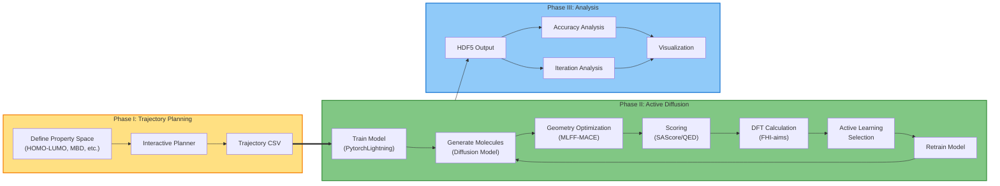
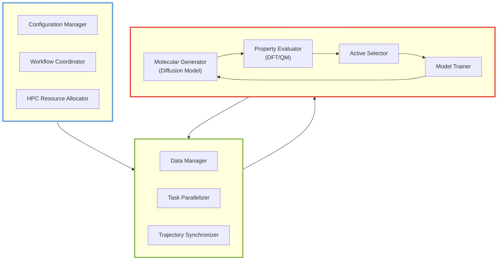

# QM Active Learning Diffusion for Molecular Design

[](LICENSE)
[](https://www.python.org/downloads/)

This model uses the Diffusion model and Density Functional Theory (DFT) through active learning to navigate chemical space and improve our generative model for molecular design.


## Overview

The QMActiveDiffusion framework combines diffusion models with quantum mechanical calculations to generate novel molecules with desired properties. The system leverages active learning to iteratively improve molecular generation by incorporating DFT feedback, enabling efficient exploration of chemical space.

**Key Features:**
- Molecular trajectory planning in property space
- Iterative active learning with DFT feedback
- HPC-optimized workflow orchestration
- Comprehensive analysis and visualization tools
- Property-guided molecular generation

## WorkFlow

The software system is organized into a modular architecture that follows a three-phase workflow, guiding the process from molecular trajectory design to data analysis. 



### Phase I – Trajectory Planning

This phase provides an interactive environment for defining molecular trajectories within a property space (e.g., HOMO-LUMO gap, many-body dispersion energy, atomic number). The resulting trajectory files (`trajectory_*.csv`) serve as input for the active learning process. 


**Tools:** Interactive trajectory planner in the `trajectory/` directory

### Phase II – Active Diffusion Execution

This represents the core operational layer of the system, responsible for orchestrating the iterative molecular generation, evaluation, and feedback process. 


### Phase III – Output Analysis

The final phase focuses on analyzing and visualizing the output. Jupyter notebooks (`accuracy_analysis.ipynb`, `iteration_analysis.ipynb`, `hdf5_analysis.ipynb`) allow users to inspect the active diffusion results, model performance, and generated molecular properties.


## Active Diffusion Architecture

The architectural elements are organized as follows:

### Surface Layer – Experiment Orchestration Layer (blue box)
Responsible for workflow coordination, configuration management, and resource allocation across HPC environments. It defines the experiment lifecycle.

### Deep Layer – Functional Core Layer (red box)
Contains the domain-specific components that implement the scientific and computational functionality of the diffusion process, including molecular generation and property evaluation.

### Utilities Subsystem (green box)
Provides cross-cutting services that support both layers by handling data management, task parallelization, and trajectory synchronization.




## Installation

### Prerequisites

- Python 3.8 or higher
- CUDA-capable GPU (recommended for training)
- HPC environment (optional, for large-scale experiments)


## Quick Start

1. **Plan a trajectory:**

2. **Run active diffusion:**

3. **Analyze results:**


## Project Structure

```
QMActiveDiffusion/
├── actdiff_experiments/    # Experiment orchestration scripts
├── analysis/               # Jupyter notebooks for result analysis
├── archive/                # Archived experiments and data
├── configs/                # Configuration files
├── diffusion_code/         # Diffusion model implementation
├── pipeline_blocks/        # Modular pipeline components
├── results/                # Experiment outputs
├── scripts/                # Utility scripts
├── trajectory/             # Trajectory planning tools
├── utils/                  # Helper functions and utilities
└── README. md
```

## Requirements

Core dependencies include:
- PyTorch
- NumPy
- Pandas
- RDKit
- ASE (Atomic Simulation Environment)
- Matplotlib/Seaborn (visualization)
- Jupyter (analysis notebooks)

See `requirements.txt` for a complete list.

## Acknowledgments

- This work was part of a research project under the supervision of Dr. Leonardo Medrano.
